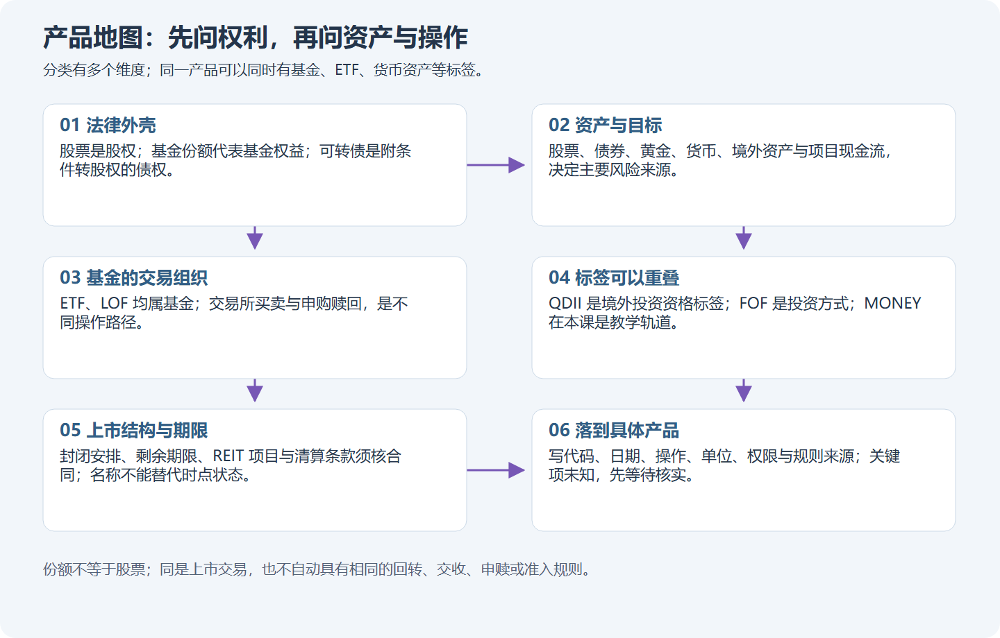
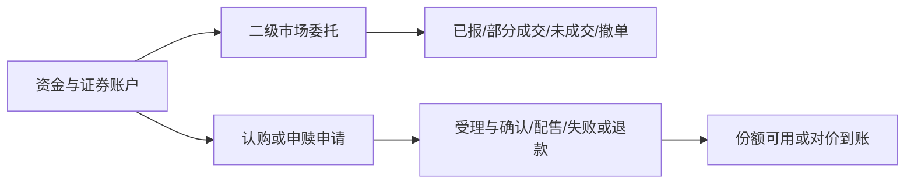

# M15 场内产品全景：先弄清买的是什么

本章接在M02账户、M03委托和M04成本风险之后。先认识产品，再看走势；不要求先学缠论。查词可以暂时进入本章，查完仍回原来的学习位置。

## U01 权利、包装与资产

### P01 一个交易账户里，装着不同的权利

买一股股票，你持有公司的一小份股东权益。买一份基金，你持有基金份额，基金按合同投资资产；基金经理不会因为你买了一份就替你保证本金。买一张可转债，你首先取得债券合同下的权利，并可能在约定条件下转成股票。三个东西都能出现K线，却不代表同一种经济关系。

设小林都有1万元：直接买一家芯片公司的股票，主要面对该公司的经营和估值变化；买一只投资多家芯片公司的基金，单家公司影响可能减小，但芯片行业一起下跌仍会影响它；买该公司的可转债，还要看信用、转股条款和期限。这里的金额只是比较起点，并非买入建议。判断风险，要沿着“我持有什么权利—资产投向哪里—什么因素改变价值”逐层问。

**随口确认：**买一份科技ETF，等不等于直接成为其中每家公司的登记股东？你直接持有的是什么？

### P02 场内是交易地点，不是单独一种资产

**场内**指通过证券交易所等相应市场机制进行业务；**场外**是另一套销售、登记和办理路径。ETF、LOF是基金的产品结构；股票型、债券型、货币型说的是投资对象；指数、主动说的是管理目标；QDII说明有关境外投资资格及业务安排。这些标签可以同时出现在同一只产品上，不是互相排斥的抽屉。

| 要问的维度 | 例子 | 不能推出什么 |
| --- | --- | --- |
| 权利与产品结构 | 股票、可转债、ETF、LOF | 不能只凭名称确定当天能否卖出 |
| 管理目标 | 跟踪指数、主动管理 | 主动ETF不能按指数跟踪目标考核 |
| 底层暴露 | 境内股票、海外股票、债券、黄金、商品期货 | 买基金不等于买无风险资产 |
| 份额类别 | 同一基金不同类别 | 不能默认费用、代码、上市状态相同 |
| 市场与业务 | 上交所/深交所，买卖/申购/赎回 | 某条买卖规则不能直接用于申赎 |

**ETF联接基金**主要通过投资目标ETF实现其目标；买联接基金份额与在交易所买ETF份额是不同的持有和办理路径。场内货币ETF既属于ETF机制范围，也进入本课的现金管理训练线。基础设施REITs和商业不动产REITs在M19分别认识，不能把REIT当普通股票型ETF。

**随口确认：**“这是一只QDII，所以一定是ETF，而且都能当天卖。”这句话混淆了哪几个维度？

## U02 价格、净值与可知时间

### P01 成交价格和每份净值为什么不同

**市场价格**来自买卖双方的成交；**每份净值**是按基金估值方法核算出的每份资产净额。假设一份基金的可比净值为1元，市场价格为1.10元，溢价率=(1.10÷1−1)×100%=10%；价格0.95元则折价5%。分母是净值，不能换成买入价后仍称同一溢价率。

价格比净值低，并不说明马上能赚差价。可能存在估值滞后、申赎限制、交易成本、底层资产停市、对冲困难，也可能是长期折价的封闭运作产品。**IOPV**是供参考的基金份额参考净值估计，依赖估算方法和输入，不是向你承诺的赎回成交价。可转债的**转股溢价率**则是债券价格相对转股价值的比值；它的分母不是基金净值。M18会重新计算。

**随口确认：**价格1.10元、净值1元，溢价10%。价格回到1元时，原买入者价格损失是10%吗？请说明分母变化。（可先算1÷1.10−1。）

### P02 显示“某日净值”，不代表当天盘中已经知道

一条估值至少记五项：**数值、估值所属日期、实际公布或可获得的时间、币种、来源**。假设周一15点前看盘，页面最终显示“周一净值1.02”，但这条净值周二才公布，那么它不能用于解释周一14点的小林为何“当时确认折价”。跨境基金还涉及海外交易时段、当地休市与人民币汇率；不同时间的两个数不能不加说明直接相除。

真实历史日线只给出报价和成交量，不能补出当时的净值、买卖价差、转股价或申赎资格。[真实产品图谱](../product-atlas.md)没有这些字段时，先记“未知”；仍可练习K线与量价，但不能声称算出了真实即时套利空间。[估值工作表](../product-worked-sheets.md)提供缺资料时如何判断和暂停的例子。

**随口确认：**周三公布的周二净值，能作为周二上午决定买入的已知输入吗？如果不能，什么材料才有帮助？

## U03 四条业务路径与规则卡

### P01 买卖、认购、申购和赎回各在做什么

**二级市场买卖**是与其他交易参与者按订单成交，钱付给交易对手；**认购**通常发生在基金募集阶段，要经历募集、确认或配售、可能退款等过程；**申购**是按适用机制取得新基金份额；**赎回**是按机制交回份额换取对价。ETF申赎可能涉及组合证券、现金替代和最小申赎单位；LOF通常还要区分登记在场内还是场外。能买100份的二级市场产品，并不意味着用同样规模就能完成申赎。

“申请成功提交”“受理”“确认”“份额可卖”“卖出所得可用”“现金可取”是不同状态。有时还要转托管，不能把它们都写成一个“已到账”。可转债转股又是另一条业务路径，见M18。

**随口确认：**小林提交了一笔赎回申请，能立刻把预计赎回款记成可取现金吗？缺少哪些状态？

### P02 每次操作都填写一张适用规则卡

规则不是给产品贴一个永久的“T+0”标签。先写具体证券、市场、日期和操作，再核查以下字段：权限与适当性、数量单位与申报增量、报价单位与最小变动、交易阶段与订单类型、撤单条件、价格限制与临停、可卖数量、交收与日历、费用税费、原始规则及生效/暂缓条款。二级买卖、申购、赎回、转股各填一张。

例：知道某只债券ETF有当日回转安排，还不能据此判断这笔赎回款今天可提现；知道债券当日能卖，也不能推断转股所得股票今天就能卖。若规则卡缺一个决定可执行性的字段，就把该项列为待核查，暂不按真实可执行处理。教学仍可用明确标出的假设继续算账，不把假设升级成交易所规则。

使用[产品业务工作表](../product-worked-sheets.md)，来源从[ETF与LOF规则](../product-sources-etf-lof.md)、[可转债与其他基金规则](../product-sources-cb-other.md)进入。数值规则有时效，复习历史案例时先找当时有效的版本。

**随口确认：**“基金都按股票规则下单”为什么会漏掉申报、回转和资金路径的信息？任选一项说明。

## U04 成本、风险与学习选择

### P01 百分比、基点与费用不要算两次

1%=百分之一；**1个基点=0.01个百分点**。费率从0.20%降到0.15%，是减少0.05个百分点，即5个基点；不是减少5%。若只比较费率本身，相对降幅是25%，分母又不同。先说清比较的是什么，再计算。

交易成本包括显性佣金等实际收取项目，以及买卖价差、滑点、等待期间价格变化等。基金管理费、托管费等通常已通过基金资产计提并影响净值；用已扣费用的净值计算收益时，不能再机械扣一次同一费用。具体费用、最低收费和税务要按产品、账户及业务核对，不提供“所有基金通用费率”。

**教学假设：**买100份价格100.10元的产品，卖价100.11元，买卖各收2元，价差收益只有1元，扣两笔费用净损失3元。高频交易次数多、价格波动小的产品，费用尤其可能吞掉毛收益。这个2元是假设，不是你的券商报价。

**随口确认：**一只基金净值已经反映管理费，拿这个净值计算区间收益后，再减一遍同一期间管理费，会发生什么？

### P02 先明确目的，再选择学习分支

短期交易关注入场、退出、流动性和执行；长期配置还要研究资产暴露、成本、再平衡与比较基准；现金管理关注安全性、流动性、可用时间及扣费后的结果。三种目的可以分别学习，但不能把“今天能交易”当成“适合短炒”，也不能把货币基金当存款。

你可以走共同基础→M15→M16 ETF→M20，也可以选择M17 LOF、M18可转债或M19其他场内基金。回到M07—M10练习同一套读图方法时，仍要声明单位、除息和估值背景；缠论只描述选定约定下的价格结构，不能替代产品机制或证明盈利。真实图形里一根很高的柱子，还要检查各图纵轴和量的单位，不能只凭外观比较风险。

**随口确认：**如果目的是备用现金管理，你首先要问的是K线是否突破，还是本金风险、何时可用、费用和收益如何计算？说出理由，再由我们确定下一小段。
