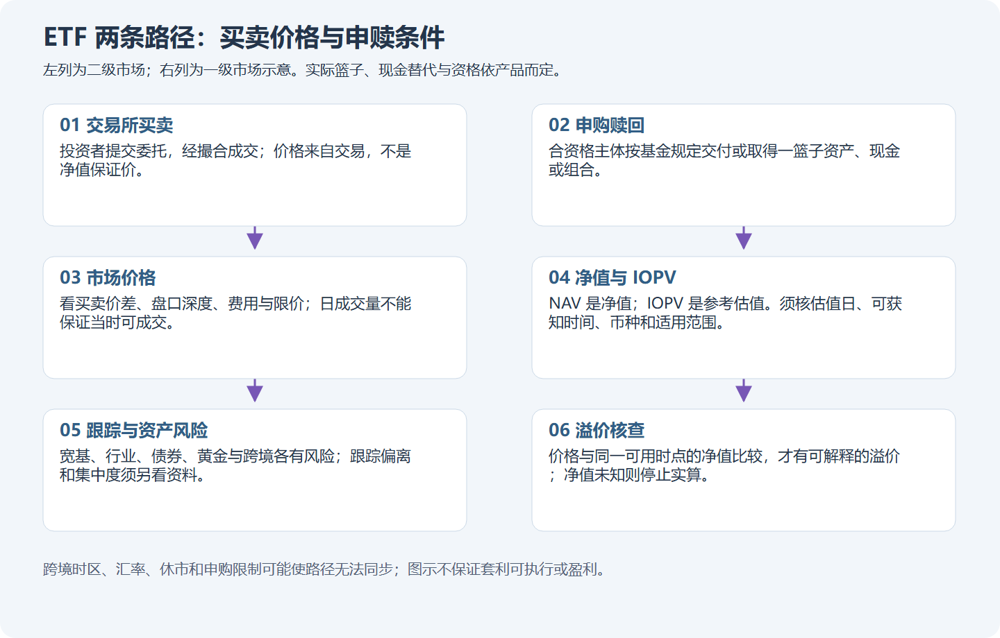
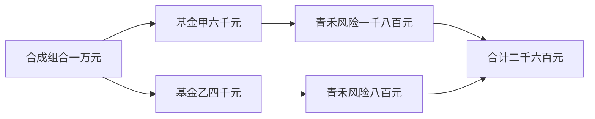
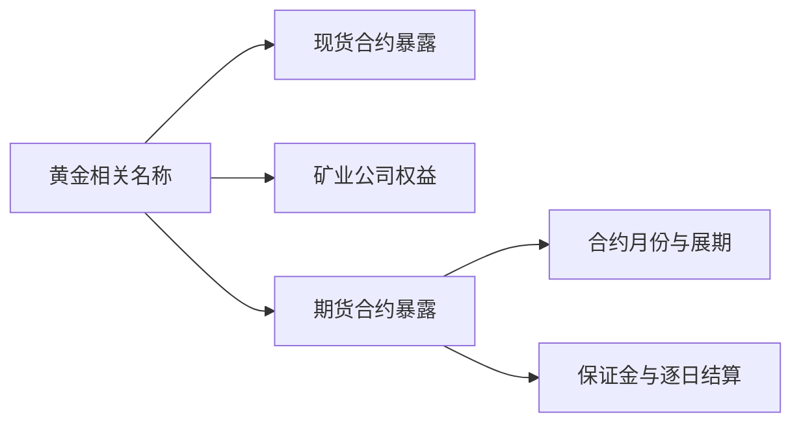
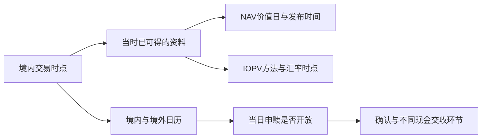

# 模块十六：ETF——先看里面是什么，再看怎样成交

ETF 是可以在交易所买卖份额的一类基金。你买到的是基金份额，基金再按合同持有资产；你不会因此直接成为每一家成份公司的登记股东。本模块跟着初学者小林，逐步分清产品、价格、办理路径和钱的去向。理解这些以后，再去读一条价格曲线，才知道曲线没有告诉你什么。

本页包含讲解过的示范，属于有帮助的学习。真实行情见[产品图谱](../product-atlas.md)，完整计算见[产品计算工作表](../product-worked-sheets.md)，分步练习见[产品实践](../product-practice.md)。阅读整张历史图后的练习不能改称未见行情的独立测验。以下所有标为“合成”的价格、费用、持仓和订单都是教学设定，不对应任何真实产品的当时成交。真实条款与事件另标代码、日期和来源，核对日为 2026-10-20。

Tutor: Give the lesson for one part with its location identifier at a time. Before each calculation, give the definition of each new term. Give only the question for the part. Then, wait. Keep the raw response and course cursor without change.

During practice with a gate, use only the learner packet for this step. Do not read subsequent outcomes to get a missing value for the cutoff. Source IDs refer to the portable source guide.

Images have portable paths. Only when you show the images in chat, change these paths to absolute paths.

## 第一单元：名字、目标和里面的资产

### 第一讲：一只基金，要用几张身份卡认识

先把“基金”理解成有合同约束的共同投资安排。管理人负责依约投资，托管人承担相应托管职责，份额持有人享有合同约定的基金权益。ETF 说明一种上市交易与运作形式；“股票”“债券”“黄金”“跨境”说明里面主要承受什么价格变化。两层信息都要看，不能拿其中一层替代另一层。

小林在[真实 ETF 图谱](../product-atlas.md)找到五个代码：510300 是华泰柏瑞沪深300 ETF，588000 是华夏科创50 ETF，518880 是华安黄金 ETF，511010 是国泰上证5年期国债 ETF，513100 是国泰纳斯达克100 ETF。它们都能出现一根根价格柱，却分别对应国内股票、黄金现货合约、国债及境外股票等不同资产。曲线长得相似，不会使风险来源变得相同。[身份依据 S05–S09](../product-sources-etf-lof.md#selected-products)

“指数基金”指以跟踪指定指数为目标的基金。指数是一套选样、权重和调整规则形成的指标，不是一个装满股票的账户。上述股票指数 ETF 需要按自己的合同实施跟踪，持仓未必每刻与指数完全一致。指数上涨也不保证基金恰好上涨同样比例。

还要留意 2026 年的新边界：深交所于 6 月 17 日发布主动管理 ETF 业务指引。主动 ETF 由管理人自主选择策略，不以跟踪特定指数为投资目标，因此不能把“ETF”一律解释为“被动指数基金”。这里说明产品定义，并不声称某只主动 ETF 在案例日已经上市。[S03](../product-sources-etf-lof.md#s03)

最后分清 ETF 联接基金：它是一只主要投资目标 ETF 的基金，投资人持有联接基金份额，不会自动持有可在交易所下单的目标 ETF 份额。联接基金也可能另有 LOF 等安排，必须看自己的合同。误把“联接”删掉，会同时看错代码、费用、申赎和可用时间。

自然检查：小林只知道某基金名字含“ETF 联接”，能否据此使用目标 ETF 的代码和交易规则来卖出自己持有的份额？

### 第二讲：篮子里有很多名字，也可能集中在一种风险

宽基指数通常覆盖相对广泛的行业，行业或主题指数则围绕指定范围选样。“比较广”仍须相对于明确对象而言，不能把宽基解释成覆盖全世界、不会下跌。588000 对应科创50，不等于把所有股票市场都装进来；某行业 LOF 与行业 ETF 还可能持有大量相同股票。

看持仓时，先确认报告对应日期、何时发布、披露范围和权重分母。半年报的期末持仓不是今天的实时持仓。只披露前十大持仓，也不能算出所有未知持仓之间的重合。小林把这些空白保留下来，才不会用一个看似精确的重合比例掩盖缺失资料。

用一组**合成持仓**算一遍：小林的练习组合总值 10,000 元，其中基金甲 6,000 元、基金乙 4,000 元；甲有 30% 投向公司青禾，乙有 20% 投向青禾，且假设这两份完整持仓同日有效。通过甲间接承受的青禾金额为 6,000×30%=1,800 元，通过乙为 4,000×20%=800 元，合计 2,600 元，占组合 26%。两只基金不等于两份彼此独立的风险。

集中度是资产集中在少数公司、行业、地区或因素上的程度。就算公司名字不重复，两只基金也可能同受科技需求、同一国家利率或同一汇率影响。反过来，有重合不自动代表组合不合格；本课先识别它，不替你规定应该持有什么比例。

常见误解是“每只都有几十家公司，所以买得越多就越分散”。正确的学习动作是先画清资产从哪一层流向哪一层，再说明自己知道和不知道的范围。真实图表上的成交额、涨幅排名和基金名称，都不能替代这张持仓关系图。

自然检查：在这组完整、同日的合成持仓中，青禾的组合暴露应记成两家公司，还是一家公司合计 26%？

## 第二单元：净值、市场价格和执行成本

### 第一讲：跟踪偏离与溢价，是两种不同的距离

净值是按基金估值规则计算的每份基金资产净值。市场价格是交易所里买卖双方成交的价格。IOPV 是基金份额参考净值，是按规定方法计算的参考量；它不是向任何人保证成交的价格，也不是所有产品都具有同样实时程度的“真正净值”。先认清这三个词，再谈贵了多少。[S04、S09](../product-sources-etf-lof.md#s09)

先补算数：1%=百分之一；1 个百分点是两个百分数相减的差；1 个基点等于 0.01 个百分点。**合成示范**中，基金同一期间净值总回报为 13%，正确口径的基准回报为 14%，跟踪差异就是 13%−14%=−1 个百分点，即 −100 个基点。这里比较的是期间回报，不是基金每份价格与指数点位相减。分红、币种和总回报口径不一致时，先不能比较。

跟踪误差关注一连串回报差异的波动程度。每期都落后相同幅度，与时而领先、时而落后，即使最终累计差异接近，也不是同一种跟踪过程。不能把“落后 1 个百分点”直接写成年跟踪误差 1%；还需要频率、样本、统计和年化约定。费用、现金比例、调仓及估值差异都可能影响跟踪，不能只凭一次偏离断言管理失误。

再看另一组**独立的合成数据**：同一币种、同一经济时点的可比净值为 1.000 元/份，市场价为 1.100 元/份，溢价率为（1.100÷1.000−1）×100%=10%。若改用 0.980 元成交，就是折价 2%。分母是每份可比净值，不能用总资产，也不能把百分数再多乘一次 100。

这个算式不自动适用于[真实产品图谱](../product-atlas.md)的任何一根柱。真实行情若只有 513100 收盘价，没有在当时可得、日期和币种合格的 NAV 或 IOPV，结论只能是“尚不能计算该口径的历史溢价”。后见到的净值可以做事后研究，不能冒充当时已经知道的数字。

自然检查：基金回报落后基准 1 个百分点，能否由此推出它今天在交易所折价 1%？

### 第二讲：成交价的差、单据上的费和净值里的费

买卖价差是某一时点最优卖价与最优买价之间的差。**合成盘口**假设买一 1.000 元、卖一 1.004 元，且每边数量足够，买入 1,000 份再立即按买一卖出，价格差损失为（1.004−1.000）×1,000=4 元，尚未算佣金。这里是假设两笔都成交，真实盘口会变化，屏幕上的数量也不是为你保留的库存。

流动性是能否以合理时间和价格完成一定数量交易的能力。日成交量很大，不证明你在某分钟能以屏幕价格成交；订单簿很薄时，大单还可能逐档成交。做市商提供报价有助于交易，但不会保证始终有足量对手盘、价格永不偏离净值或任何时刻都能退出。[真实图谱](../product-atlas.md)的量柱只说明已发生交易，不能补造盘口。

订单要区分“已提交”“部分成交”“全部成交”“撤单申请中”“撤单确认”。**合成订单**买 1,000 份，先成交 400 份、价格 1.004 元；随后确认撤销剩余 600 份。只有 400 份进入已成交持仓，未成交部分不是亏损，也不是已经持有。外部费用假设明确为本次合计 1 元，则支出为 401.60+1=402.60 元；只在规定位置把费用舍入到分。

还有基金管理费、托管费等从基金资产中计提的费用，与券商单据上的交易佣金不同。真实 510300 的所引文件列年管理费 0.15%、托管费 0.05%，513100 列 0.6%、0.2%；它们不是每买卖一次就收的百分比，也不是产品总成本的完整承诺。[S05、S09](../product-sources-etf-lof.md#fee-boundaries) 用已经受这些费用影响的 NAV 算回报，再从账户扣一遍管理费，会重复扣费。真实模拟账还要填实际佣金、最低收费及适用规则；未知时只能明确设为合成，不能默认零。

自然检查：合成订单只成交 400 份后确认撤销余量，小林应按 1,000 份还是 400 份登记持仓？

## 第三单元：债券与黄金，不能套用股票的理解

### 第一讲：债券 ETF 也有价格变化，先分利率与信用

债券是一种约定还本付息的债权。债券 ETF 持有一组债券等资产，你持有基金份额，而不是一张保证在某日按你买入价格兑付的债券。债券发行人的到期还本安排，也不会变成基金对你买入价的保本承诺。[511010 真实图谱](../product-atlas.md)中的每份价格就是市场价格，仍可上下变化。

利率风险来自市场要求回报的变化。为理解方向，先看**合成零息债券**：两年后只支付 100 元，不考虑违约和费用；若每年要求回报为 2%，现值为 100÷1.02²≈96.12 元；若要求回报变为 3%，现值为 100÷1.03²≈94.26 元。同样一笔未来现金，折算回今天的金额变少，说明市场利率上升时，既有固定现金流价格通常下降。

久期可先理解为债券价格对收益率变动的敏感程度，不简单等于剩余年限。进一步的**合成近似**假设修正久期为 4 年、收益率小幅上升 0.50 个百分点，价格变化约为 −4×0.005=−2%。若原价 100 元，近似变成 98 元。这个式子忽略凸性、时间经过、利息等影响，不能用于给真实 511010 编造当时久期或精确收益。[计算扩展](../product-worked-sheets.md)

信用风险则关乎发行人是否能如约支付，信用利差是相对选定基准的额外要求回报。另一只**合成信用债组合**若久期 3 年、基准利率不变而信用利差增加 1 个百分点，简单近似价格影响约 −3%；这不是国债基金 511010 的真实持仓或预测。延期、违约和流动性恶化还可能产生比简单近似更复杂的损失。

真实 511010 跟踪上证5年期国债指数，所引 2026 年说明书说明其抽样、费用及估值可能导致偏离。[S08](../product-sources-etf-lof.md#s08) 同样叫“债券 ETF”，国债、信用债、可转债等产品的信用与利率暴露也不同。交易所允许某些债券 ETF 当日回转，只说明交易权限的一层，不能消除价格和结算风险。

自然检查：在合成修正久期 4 年、收益率上升 0.50 个百分点的近似中，价格影响为何应写成约 −2%，而不是保证收到 2% 利息？

### 第二讲：黄金现货、矿业股票与期货展期不是同一回事

现货可先理解为现时交付安排下的实物资产交易；期货是按合约约定在未来交割或结算的标准化合约；黄金矿业股票则是经营企业的权益。这三类东西都与黄金有关，却有不同的现金流与风险。矿业公司还受成本、负债和经营影响，期货还涉及合约月份、保证金和展期，不能把它们都看成仓库里的一块金条。

真实 518880 的文件说明其主要持有上海黄金交易所黄金现货合约，跟踪国内黄金现货价格。[S07](../product-sources-etf-lof.md#s07) [黄金真实图谱](../product-atlas.md)展示基金交易价格，不是直接报价一克黄金，更不是你持有实物的重量。基金每份价格、黄金合约报价及国际金价各有单位，不能把它们的数值直接相减。

展期是把临近到期的期货暴露换到较远月份。借一组**纯合成、无真实代码的期货暴露**说明：账户权益 100 元，价格乘数假设为 1，近月报价 100，远月报价 110。平近月、开远月的时点假设没有价差损益及费用，账户不会因为两个月份价差 10 就立刻变成 90 元；期货也不是把 110 元全额买入一件商品，开仓涉及保证金规则。

为便于算数，允许小数“合约等价量”，并假设新暴露名义金额仍为 100 元，则远月数量是 100÷110≈0.9091。若之后现货维持 100，而远月从 110 降到 100，合成损益约为 0.9091×（100−110）=−9.09 元。损益发生在后续价格变化；真实合约有乘数、整数张数、逐日结算、抵押品收益及费用，不能按这个小数下单。[展期工作表](../product-worked-sheets.md)

常见误解是“现货没有涨，所以任何商品基金都不应亏”或“换月当天必然扣掉远近月差”。基金暴露、合约曲线、持有区间和成本不同，都需要逐项解释。下一模块的 161226 是白银期货 LOF，不能把它改叫黄金现货 ETF，也不能把本讲合成的远月情景写成它的真实表现。

自然检查：这组期货合成情景中的约 9.09 元损失，来自换月时自动扣款，还是后来远月从 110 变为 100 的价格变化？

## 第四单元：跨境时钟与完整操作核验

### 第一讲：同一个“今天”，可能有几只不同的钟

QDII 指合格境内机构投资者开展境外证券投资的制度安排；它说明跨境投资资格与路径，不能单凭这几个字推出所有交易规则。人民币交易也不等于没有外汇影响。**合成换算**假设境外资产价值固定 100 美元，美元兑人民币由 7.00 变为 7.10，不计费用等，人民币价值由 700 元变为 710 元，增加约 1.43%；资产的美元价格没有上涨，人民币计价结果仍有变化。

NAV 的价值日期、发布时间、你实际能读到的时间，是三项不同记录。再加交易所当前时点、美国市场开休市、外汇与银行办理日、基金申赎服务日，至少要并排看几只钟。IOPV 即使频繁发布，也可能包含先前价格、汇率或估算，不能仅凭屏幕刷新就当成完整实时 NAV。[S09](../product-sources-etf-lof.md#s09)

真实 513100 的 2026 年 9 月 15 日说明书区分上交所工作日与沪美共同申赎开放日，并载明 T 日 NAV 在 T+1 计算、T+2 内公告。本讲先记清：净值何时计算、何时公布，不能直接推成资金何时可取。申购的资金核对、赎回款划付是另外的办理流程，留到核对具体操作时再读；不能一句“跨境都 T+2”包办所有时点。[结算适用表](../product-sources-etf-lof.md#timing)

一个真实日历案例是国泰 9 月 2 日公告：513100 等产品因美国劳动节于 9 月 7 日暂停相关申赎等业务，节假日原因的恢复安排为 9 月 8 日，同时明确原有其他限制仍然有效。[S17](../product-sources-etf-lof.md#s17) 不能把“假日后恢复”理解成撤销所有额度或申购限制，也不能据此断定交易所当天必然停牌。

回看 8 月 31 日时，9 月 15 日才发布的说明书只能作后来的教学解释，不能当成小林当日已经持有的资料。真实图谱若缺当时的 NAV 可得时间，就保留未知；合成 FX 算术也不能替代这个缺口。

自然检查：9 月 8 日节假日原因的申赎恢复，能否证明此前另有原因的申购限制也同时取消？

### 第二讲：用 2026 年真实公告，把“能买卖”拆开核对

真实事件看 513100。管理人 2026 年 9 月 30 日公告，二级市场价格明显高于基金份额参考净值，并安排当日开市至 10:30 临时停牌。同日另一份公告规定自 **10 月 8 日**起暂停申购，赎回等业务正常办理，恢复时间另行公告。[S15、S16](../product-sources-etf-lof.md#actual-events) 前者涉及当天交易安排，后者涉及未来一级市场业务，两者不能合并成“9 月 30 日全天什么都不能做”。

把[9 月 30 日真实图谱](../product-atlas.md)与公告并排，是练习读取事实的起点。公告没有给可用于本案例的同步数值 NAV 和溢价率，因此本讲不填写一个猜来的历史溢价。若观察截止早于公告实际可得时刻，也不能使用该公告指导当时决策；只知道公告日期而不知道日内可得时刻，应明示这一限制。公布的停牌安排也不自动证明之后每分钟都按预期复牌。

ETF 申赎暂停不等于所有现有份额不能交易；交易停牌不等于所有赎回停止；有申赎价格也不等于任何小额持有人都满足篮子单位与渠道资格。510300 买入份额当日可否卖出，与当日可否赎回就是不同问题；518880、511010 与合资格跨境 ETF 的回转规则又不同。[S01、S05、S07–S09](../product-sources-etf-lof.md#timing)

小林把操作表填成下列几行，未知的必要字段留空就暂停真实执行模拟，不以产品名称补齐：

| 核对对象 | 必须明确的内容 |
| --- | --- |
| 身份与当时状态 | 代码、类别、份额、交易所、日期、权限、公告可得时刻 |
| 这一次操作 | 买卖或申赎、最小数量与增量、报价单位、价格最小变动、交易阶段和订单类型 |
| 订单与异常 | 撤单规则、涨跌幅限制、临时停牌、部分成交及余量处理 |
| 资产与现金 | 已有/冻结/可用份额，可用/冻结/已交收/可取现金，确认与交收日历 |
| 成本与依据 | 外部实际费用、内含费用边界、规则版本、生效日及例外 |

进入[产品实践](../product-practice.md)后，先识别并核验，再写计划或有证据的“不交易”，然后处理订单与事件，最后逐笔对账。合成订单可以事先声明缺失规则的假设，但不得把它说成真实历史成交。暂不交易也不是自动满分，必须说清缺哪项证据或哪条预设条件不满足；已经成交的部分与已有持仓仍要跟踪。

自然检查：面对 9 月 30 日发布、10 月 8 日起生效的申购暂停公告，小林能否把它登记成“9 月 30 日已暂停申购”的事实？
