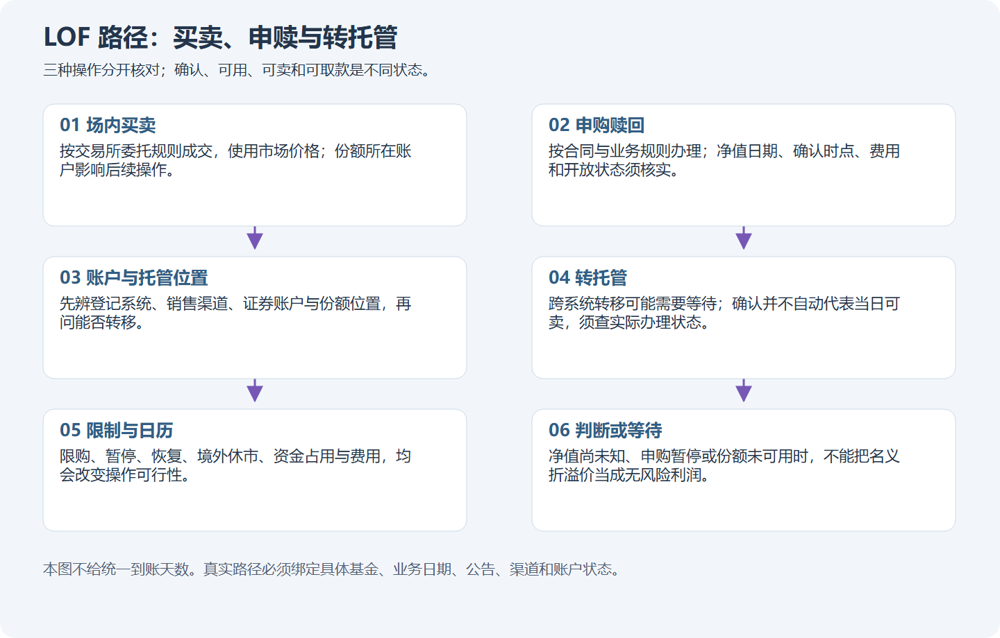
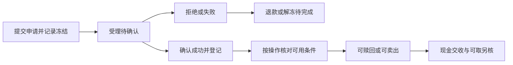
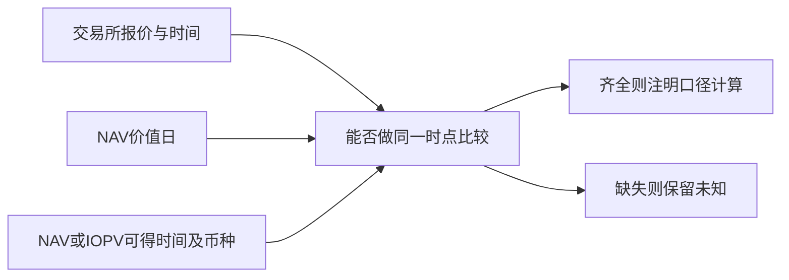
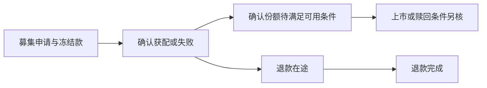

# 模块十七：LOF——同一份基金，几条路径与几种等待

LOF 是上市开放式基金。先用一个生活化的理解：小林持有某种基金份额，既可能在交易所与另一位投资人买卖，也可能按基金规定向基金申请申购或赎回；份额放在哪个登记系统、采用哪条渠道，会影响这次操作能不能办理。名字里的“上市”和“开放”都不能替代当天公告。

本页是讲解过的学习示范。真实价格图见[产品图谱](../product-atlas.md)，详细计算见[产品计算工作表](../product-worked-sheets.md)，完整分步练习见[产品实践](../product-practice.md)。所有合成数量、价格、日期代号、账户、费率与成交设定均只用于算术，不代表某只真实产品当时可以执行。实际条款以注明适用范围的[ETF/LOF 一手来源](../product-sources-etf-lof.md)为依据，核对日为 2026-10-20。

Tutor: Give the lesson for only this part with its location identifier. Then, give its one question. Wait for the raw response. Keep raw responses and the course cursor without change.

This page contains worked examples with aid. These examples are not assessments of material that the learner did not see previously.

During practice with a gate, use only the learner packet for this step. From a previous prospectus or chart, do not get these facts for a previous decision time:

- Subscription availability
- Completion of the custody transfer between LOF registration systems
- A fill
- A premium.

Only when you show images in chat, change their portable paths to absolute paths.

## 第一单元：基金身份与三种操作

### 第一讲：LOF 说的是形式，不保证里面投资什么

基金份额代表按合同享有的基金权益，不是一张定期存款单，也不是对买入价格保本的凭据。LOF 可以有指数化投资目标，也可以采用主动管理策略；“LOF”本身没有替你决定投资对象、分散程度、费用和收益。读一只基金时，先分形式、目标、资产、份额类别、上市地点，再问操作规则。

看[真实 LOF 图谱](../product-atlas.md)里的两个例子。161725 是招商中证白酒指数基金的上市 A 类份额，以指数化方式投资白酒股票；161226 是国投瑞银白银期货基金的上市 A 类份额，主要承受白银期货相关风险。白酒是公司经营与股票价格，白银期货涉及商品价格、合约月份及展期；即使两张图都用“元/份”，也不是相同的资产。[S10–S12](../product-sources-etf-lof.md#selected-products)

再看三个容易混淆的修饰词。“指数”说明投资目标；“QDII”涉及境外投资制度与路径；“联接”说明主要投资目标基金的安排。它们都不能直接替代 LOF 的上市形式。真实易方达纳斯达克100 ETF 联接基金的 A 类人民币份额 161130 就有 LOF 安排，是理解“联接基金也可以上市”的一例，但它与目标 ETF 是两只不同基金，不能混用代码与账户份额。[S20](../product-sources-etf-lof.md#s20)

份额类别也要分清。161226 的所引文件中 A 类 161226 上市，C 类 019005 不上市，除非以后另有有效安排。不能看到同一管理人、同一投资目标，就把 C 类份额按 A 类价格卖出。161725 的 A/C 类注册登记安排也不同，跨系统转托管并非对所有类别都开放。

“有很多股票”也不意味着没有集中风险。白酒指数 LOF 仍集中于其行业范围；它和白酒 ETF 可能大量重合。小林写的是“我理解这份额最终承担什么风险”，而不是“换一个包装就算新增一种分散”。本讲不依据这些分类给出买入或配置比例。

自然检查：161226 的 C 类份额与 A 类投资目标相近，是否就能直接输入 161226 的场内代码卖出 C 类持仓？

### 第二讲：买卖、申购和赎回，先说清自己按了哪个按钮

场内买卖是你与市场中的另一位投资人交易已存在的份额，成交价格由撮合形成。申购是按基金规定交付申购款、申请新增基金份额；赎回是申请减少持有份额并取得相应款项。基金系统显示“已受理”，只说明申请进入处理流程，不说明你已经得到可交易份额或现金。

“场内”也不等于“买卖”。符合条件时，证券公司的场内系统可能同时提供交易所买卖与场内申赎入口。前者填价格与数量，后者按申赎规则、申请日的基金净值及费用处理；界面在同一软件里，法律与计算路径仍不同。[S04、S10、S12](../product-sources-etf-lof.md#timing)

先做**合成申购计算**：申购总额 10,000 元，假设前端申购费率 1%，申请日最终可用净值为 1.000 元/份，按这组设定，净申购金额为 10,000÷1.01≈9,900.99 元，费用约 99.01 元，算出的份额约 9,900.99 份。份额如何取整、尾差如何处理必须另声明，不能因为场内买卖常见整数单位，就自行把所有申购尾数截去。

换成一笔**独立的合成场内交易**：以 1.050 元/份买入 1,000 份，假设成交已经确认、显式交易费用合计 2 元，账户支出为 1,000×1.050+2=1,052 元。这里没有按上一段的申购费率另扣 1%，也没有向基金申购 1,000 份。两笔各有成本依据，不能只挑看起来便宜的一行比较。

真实 161725 A 的资料摘要区分场内赎回与场外赎回的持有期费率，场外申购还分金额档次；这些不是它的场内卖出佣金。[S11](../product-sources-etf-lof.md#s11) 费用是按次、按金额、按持有期还是按年计提，也要逐项说清。年管理费和托管费已影响基金净值，不能在净值回报中再扣一遍。

沿着上方路径图读一遍：买卖通往交易撮合，申赎通往基金业务处理，转托管则改变登记/托管渠道。按钮相似不是同一种交易。真实演练若缺当前申赎状态、适用份额或费率依据，先停在核验，不用合成数字替它开通业务。

自然检查：合成场内买入 1,000 份已按成交价和显式费用记账，能否再机械加扣另一笔合成申购示范中的 1%？

## 第二单元：确认、可用和跨系统转托管

### 第一讲：申请成功之前，钱和份额分别在哪里

把“等待”拆开，就容易看清账户。已提交是申请发出；已受理是渠道收到；已确认是登记机构认定有效；已登记是权益记入；可用则必须补上“可用于什么操作”。可查询、可赎回、可在交易所卖出、资金可再交易、资金可取到银行，不是同一个时点。

真实 161725 的所引说明书规定正常申赎申请在 T+1 内确认，T+2 起可查询确认情况，申购成功后的份额自 T+2 起可赎回或转换转出；赎回款有 T+7 内划付以及特殊顺延条款。161226 所引文件也分别列确认、登记、赎回与划款安排。[S10、S12](../product-sources-etf-lof.md#timing) T 是该操作定义的有效申请日，后面的日数必须按合同中的工作日定义数，不能直接加自然日。

**合成账户**原有现金 12,000 元、无份额，提交 10,000 元申购后，假设销售渠道冻结该款：可用现金 2,000 元，冻结现金 10,000 元，已确认份额仍为零。若收到“已受理”就同时登记 10,000 元可用现金和新增份额，等于把一笔资产算了两次。

假设随后确认失败，系统显示“退款处理中”，也不能立刻把冻结款当成可取现金。只有记录实际退款/解冻完成后，才把相应金额移回可用栏。确认成功的分支则应把资金消耗、费用、确认份额和仍未满足的可用条件分别登记。不能只看期末总资产，忽略过程中一笔订单占用了哪些资源。

真实图谱能说明基金价格在那个交易日发生了什么，不能证明小林的申请有效、渠道已汇款或银行已到账。节假日、巨额赎回、异常处理等例外也不能隐藏在“通常”两个字后面。当前申请的结果未知时，账上保留待处理状态，并继续管理已有持仓。

自然检查：一笔申购显示“已受理、待确认”时，能否把预计份额直接记为可卖持仓？

### 第二讲：转托管搬的是登记位置，不是多买一份

跨系统转托管，是把同一类合格份额在场外开放式基金登记系统与场内证券登记结算系统之间办理转登记；它不是更换基金托管银行，也不是卖掉旧基金再买另一只基金。系统内转托管则是在同一登记系统内变更销售机构、会员或交易单元，不能把两类业务的办理条件混为一谈。

真实 161725 所引说明书明确跨系统转托管仅适用于 A 类，具体按中国结算规定办理，销售机构可以按规定收取转托管费。[S10](../product-sources-etf-lof.md#s10) 161226 的 A/C 类限制也不同。因此先查类别、账户对应、转入证券公司的业务能力、交易单元、可转数量和费用，再讨论几天到账。不能承诺“所有 LOF 转托管免费”。

用**合成数量账**跟一次：场外已确认、可转份额为 1,000 份，场内为零；申请转入场内 400 份。假设转出渠道已冻结这 400 份，则场外可用 600 份、跨系统在途 400 份、场内可用零份，总权益仍为 1,000 份。不能在转出端未扣减时又增加场内可卖 400 份。

| 合成处理节点 | 场外可用 | 转托管在途 | 场内可用 | 总份额 |
| --- | ---: | ---: | ---: | ---: |
| 申请前 | 1,000 | 0 | 0 | 1,000 |
| 转出冻结已生效 | 600 | 400 | 0 | 1,000 |
| 假设登记及可用条件均完成 | 600 | 0 | 400 | 1,000 |

若申请被拒绝，就记录失败原因与份额实际解除冻结的时刻；若仅显示转入记录而可卖数量未更新，仍停在不可卖状态，不能抢先下卖单。接收机构、份额类别、账户对应错误，都可能影响结果。一次申请的回执应与最终登记记录核对。

深交所 2021 年投教页面给出有效场外转场内申请 T 日、T+2 起可场内卖出或赎回的基线，但它不是对所有 2026 年产品与渠道的服务时限担保，且本次未完整核验最新中国结算实施细节。[S18](../product-sources-etf-lof.md#s18) 真实操作表仍应补查；这里用节点描述，不把某个早年的通用时限强塞给当次申请。转移期间市场价格仍可能变，路径图不能保证价差留在原处。

自然检查：合成账户转出冻结 400 份而转入尚未可用时，总权益应是 1,000 份还是 1,400 份？

## 第三单元：溢价、限制与跨境资料时点

### 第一讲：真实白银 LOF 事件，三种业务可以同时处于不同状态

2026 年 4 月 3 日，国投瑞银就 A 类 161226 发布溢价风险提示及停复牌公告，指出二级市场价格明显高于基金份额净值，安排当日开市至 10:30 停牌，同时说明停牌期间赎回照常办理。公告还说明本基金自 1 月 28 日起暂停申购，包括定期定额投资，恢复时间另行公告。[真实公告 S13](../product-sources-etf-lof.md#s13)

先不用猜行情，光读业务状态就能学到三件事：交易暂停，申购已经暂停，赎回仍可办理。三种状态不是一个总开关。公告讲“暂停申购”，不能改写成“投资人不能卖出”；讲“赎回照常”，也不等于每位投资人当场收到钱，还要符合份额、渠道、确认与划款条件。

上方[路径图](../../assets/product-diagrams/03-lof-paths.png)里，市场买卖与基金申赎是两条线。溢价可能吸引人设想先申购、再转托管、再卖出，但每一条边都有自己的状态与等待。如果申购入口已经关闭，就不能把第一步写成已经成功；哪怕此前存在额度，额度也可能只对指定类别、渠道或日期生效。

**合成价差示范**假设同一时点可比 NAV 为 1.000 元/份，场内价为 1.200 元/份，表面溢价为 20%。假设三日后才能具备场内卖出资格，而到时价格为 0.980 元，原先 0.200 元的差额就不再存在。更不能把申购费、持仓期赎回费、转托管费用、未成交与限制一律设为零，再称为确定利润。此例没有真实代码和日期，也不预测真实 161226 的后续价格。

管理人暂停业务的实际原因要以原公告为准，不能因为看到商品上涨、资金热度或某个市场传闻就自行推定。同样，本次 4 月 3 日公告不能证明限制一直延续到 8 月 31 日、9 月 30 日或今天；必须找到日期衔接的有效公告。缺这一段状态证据，小林可以读价格图，但不能声称已经还原完整套利路径。

自然检查：4 月 3 日公告同时写交易停牌、申购暂停、赎回照常，小林应把三条业务记成同一个“全部关闭”状态吗？

### 第二讲：旧净值不是假净值，却可能回答错时间的问题

再看一份真实 161226 公告。2026 年 8 月 7 日披露：8 月 6 日收盘价为 2.035 元，而所列基金份额净值 1.6639 元对应 **8 月 5 日**；并安排 8 月 7 日开市停牌、10:30 起复牌，赎回照常办理。[S14](../product-sources-etf-lof.md#s14) 这是一组真实披露的不同日期数据，不能给其中的 1.6639 元换上“8 月 6 日实时净值”的标签。

“相对最近已披露净值的比值”与“相对同一经济时点净值的溢价”是不同口径。公告提醒风险可以是真实事件，但它没有为本课程提供所有同一时点估值和可得性证据。尤其把[8 月 31 日或 9 月 30 日价格图](../product-atlas.md)拿来时，不能从这一份公告外推对应日净值、溢价或停牌状态，也不能利用后来公布的同日净值反装成当时可知。

跨境 QDII LOF 还多一层时差和日历。真实易方达 2026 年 1 月 14 日公告把 161130 等基金列入 1 月 19 日因境外市场假日暂停相关业务的名单，并安排 1 月 20 日节假日原因的恢复，原有其他限制继续适用。[S20](../product-sources-etf-lof.md#s20) 这里的日期只适用该公告与所列基金，不能把另一只 ETF 的 NAV 公布时限复制给所有 LOF。

再用**合成跨境换算**理解 FX：假设一份底层资产值 2 美元，汇率为每美元 7 元，则是 14 元；若资产仍为 2 美元、汇率变为 6.8 元，则为 13.6 元，变化约 −2.86%。这不是某只真实基金的净值估算，还未计持仓、现金、税费和估值规则。一个境外指数点位也不能直接换算成基金每份 NAV。

限制还可能来自产品文件规定的外汇额度等条件，但一只产品的风险条款不能证明另一只的暂停原因。[S21](../product-sources-etf-lof.md#s21) 小林的资料卡至少留下价值日、首次可得时刻、观察时刻、币种、估值/汇率方法和来源；未知栏不以“应该差不多”补上。

自然检查：8 月 7 日公告列出的 1.6639 元对应 8 月 5 日，小林能否把它当成 8 月 6 日收盘时的同步 NAV？

## 第四单元：完整账户与生命周期

### 第一讲：把计划、成交、结算和损益接成同一本账

在[产品实践](../product-practice.md)里，一次完整练习要经过四步：识别并核验，计划或有证据地不交易，管理订单和事件，最后对账复盘。只算“买了以后涨多少”会跳过中间三分之二的工作。真实订单还需要当日规则与账户资格，合成练习则把假设逐条写明，不能冒用真实产品的名字充当规则证据。

**完整合成示范**假设普通国内权益 LOF 式场内买卖情景：期初现金 10,000 元、无持仓，买入增量设为 100 份、价格最小变动设为 0.001 元，订单类型为限价；设定当前允许委托与撤销未成交余量，买入份额当日不可再卖。真实交易所阶段、限制、权限及实际交收仍须另查，这些设定只服务本题。[操作字段依据](../product-sources-etf-lof.md#operation-fields)

小林计划最多买 1,000 份、限价 1.100 元。假设渠道先冻结 1,102 元，其中预留外部费用 2 元，可用现金为 8,898 元。后续收到两个确认成交：400 份×1.090=436 元，200 份×1.100=220 元；两笔实际外部费用合计假设为 2 元。确认撤销余下 400 份后，剩余冻结款按本题假设释放，累计支出为 436+220+2=658 元，现金为 9,342 元，持仓 600 份。

| 合成节点 | 现金处理 | 份额处理 |
| --- | --- | --- |
| 委托已冻结 | 可用 8,898，冻结 1,102 | 未成交份额不是持仓 |
| 成交及撤余量均确认 | 支出 658，释放余款 444 | 已成交 600，待满足卖出可用条件 |
| 假设后续已具备卖出资格 | 按当时实际可用状态登记 | 600 份可用 |
| 假设全部按 1.120 卖出 | 收入 672，外部费 2，净回款 670 | 剩余持仓为零 |

全部卖出后总现金为 9,342+670=10,012 元，已实现净损益为 12 元，假设无分红与其他现金流。这个数字来自给定成交，不是从日线最高最低猜出的可成交价格。卖出后可用于证券交易的资金，也必须与可取到银行的钱分栏；本题没有实际提现日证据，不能擅自补一日历日期。

若一直没有满足可卖条件，就保留 600 份，不能用未来卖出回款支付今天另一笔委托。若根本未成交，就记录无成交与冻结释放，而不是虚构一次盈利。管理费已影响实际价格/NAV，不把年费再机械从 12 元中扣除；有分红时另核权益登记、除息与现金收到，避免既计价格调整又重复计现金。

自然检查：本题两次实际成交合计 600 份且撤余量已确认，小林可否把原计划的 1,000 份全算成已买持仓？

### 第二讲：认购、暂停、恢复和终止，都要走到钱份对上

认购通常发生在基金募集阶段，申购通常发生在基金成立后的开放安排中。两者都不是“按下按钮立刻得到可卖份额”。募集时还可能涉及份额确认、比例配售、未获配款退款、成立条件和上市日期；具体产品有没有这些安排，必须读自己的发售文件，不能套用股票打新规则。

做一组**纯合成募集情景**：期初 10,000 元全部提交并冻结，假设最终获配 80%、每份确认价 1 元、无费用、无利息，确认 8,000 份，待退款 2,000 元。此时可用现金仍为零、退款在途 2,000 元、已确认份额 8,000 份；没有合格上市/可用记录，不能直接登记为 8,000 份可卖。实际退款收到后，现金再从在途变为可用 2,000 元，总资产不会因为状态变化凭空增加。[生命周期工作表](../product-worked-sheets.md)

暂停与恢复也要核对具体业务、份额类别、起始日和另有约束。前面 161226 的真实事件证明，交易停牌、申购暂停、赎回办理可以并存。另一只产品节后恢复的公告，既不能给 161226 开通申购，也不能自动解除自己仍有效的大额限制。超过额度时可能全部拒绝或部分确认，只有当次规则和实际结果才能决定记账分支。

终止上市、基金合同终止和清算同样不是一个词。终止上市涉及交易所交易渠道；基金是否继续存在、能否场外赎回，要看正式安排。基金清算还可能经历资产处置、费用扣除和剩余财产分配，不能把最后一个收盘价当成保证清算价。2026 年 8 月 7 日上交所 LOF 安排的文件属于征求意见通知；本课程没有由它确认某产品已经终止上市，也不能把征求意见截止日当作生效日。[S19](../product-sources-etf-lof.md#s19)

复盘最后应能回答每笔钱和每份单位的去向：期初持仓，加确认新增，减已成交卖出和已确认赎回，调整转移在途等状态，核对期末持仓；期初现金加真实回款与实际分配，减真实支出与显式费用，核对可用、冻结、交收和退款在途。没有处理完的申请继续挂账，期限未知就写未知，不能为得到漂亮总数强行结案。

自然检查：合成认购已确认 8,000 份、2,000 元尚在退款途中且上市可用条件未知时，能否登记成“8,000 份可卖、2,000 元可立即取款”？
