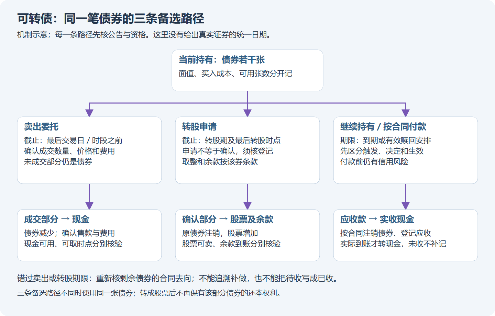
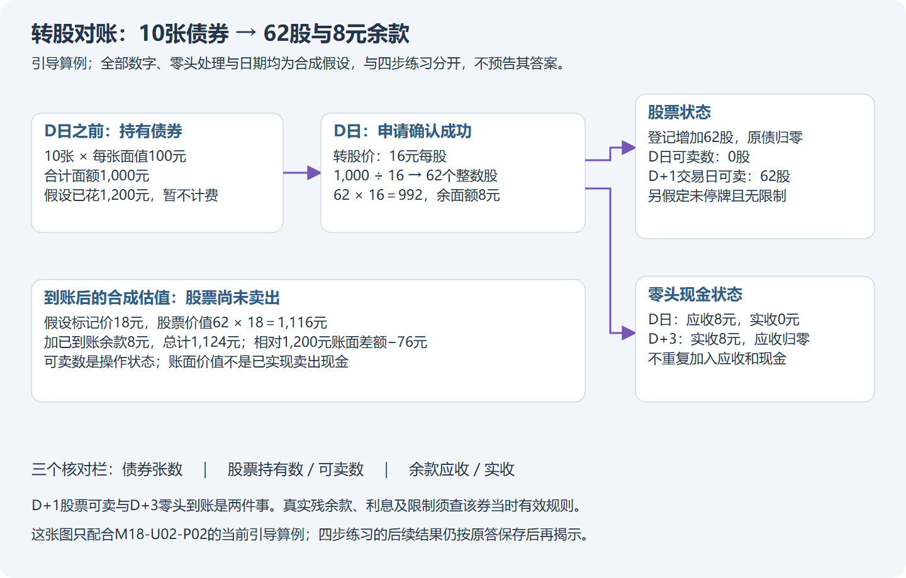

# 模块十八：可转债的两种权利与每一条退出路径

可转债把借款关系与转股选择放在同一份合同里。小林先学会认清自己持有什么，再计算价格，最后把公告、截止时间与账户变化接起来。本模块使用真实公告讲事件，使用明确标注的合成数字讲计算；没有把二者拼成未经核验的真实收益。

Tutor: Give the lesson for one part with its location identifier for each tutor message. Give only its last question. Before you give hints, keep the raw response.

All solutions that you show are guided examples. They are not assessments of material that the learner did not see previously. Read only the atlas packet or practice packet for this step. For a previous cutoff, do not open teacher outcomes or full reports for dates after the cutoff.

When necessary, use [source registry](../product-sources-cb-other.md), [case atlas](../product-atlas.md), [practice](../product-practice.md), and [worked sheets](../product-worked-sheets.md).

With missing operation fields, you cannot be sure that the operation is possible in the market. Arithmetic can continue with synthetic inputs that have a synthetic label.

## 第一单元：先读懂债、股和价格

### 第一讲：买入的是债券，也是一项有期限的选择

“债券”可以先理解成按合同约定还本付息的借款凭证。“可转”表示持有人能在规定期间，按约定价格把这笔债权换成发行公司的股票。发行公司是借款人；正股就是将来可换得的那家公司股票。小林买温氏转债，并没有立刻买入温氏股份；在有效转股完成前，他仍持有债券。

用虚构青禾制造说明：一张债券面值100元，是合同计算本金的单位；市场成交价可能是120元。小林花120元买入，不能要求公司因为自己买贵了就按120元还本。票面利率也通常以面值为计算基础，不以个人买入价为基础。假设某年的票息为面值的2%，一张对应2元毛利息；这不等于小林花120元的资金获得2%的收益。这些数字都是教学假设，不是青禾制造真实发行条款。

转股后，原有债权按规则减少，持有人取得股票，承担股价波动。股票没有因为来自转股就保留“到期还本”的权利。股票数量增加还可能摊薄原股东权益，即原来每股对应的公司份额会变化；不能只数自己多了几股，就断言所有股东共同变富。

看下图时，先沿箭头认清“债券—卖出现金”“债券—转股后股票”“债券—按合同付款”三条路径，再找各自截止时间。图是机制示意，价格与节点不能替代真实公告。

真实身份方面，123107是深交所上市的温氏转债，发行人为温氏食品集团股份有限公司，正股300498。2026年7月1日的发行人报告确认其约定转股期为2021年10月8日至2027年3月28日；实际期间仍可能受到停转股、赎回等事件影响。这个后来报告可以核对身份，不能证明某个更早时点已经知道其中全部内容。见[温氏身份及转股期间来源](../product-sources-cb-other.md#wens-adjustment)。

自然检查：小林花120元买入面值100元的债券，公司按合同归还100元本金，为什么不能只凭“还本”二字判断自己没有亏损？

### 第二讲：转股价值和溢价回答不同问题

转股价格表示用多少元债券面值换一股股票。它不是债券成交价，也不是正股市价。先忽略整股取整与零头处理，每张面值100元债券的理论转股价值为“100元面值÷转股价格×正股价格”。分子是面值，分母是每股转股价格，最后得到对应股票的市场价值。

以下全部是合成算例：转股价格16元/股，正股18元/股，债券报价120元/每100元面值。理论上，一张对应6.25股，价值112.50元；转股溢价率为“120÷112.50−1”，约6.67%。含义是债券成交价比当前理论转股价值高约6.67%，不是“转股后必赚6.67%”。若股价下跌，理论价值也会下降；实际转换还要考虑整股、零头、费用、时间与股票可卖状态。

债券为什么可能比理论转股价值贵？持有人还保有将来转股的选择，债券也有票息、到期与其他合同权利；市场可能愿意为这些因素付价。但高溢价意味着当前价格已经包含较多期待，不能由“正股涨了”直接推出债券一定涨得一样多。相反，低溢价也可能伴随信用、流动性或临近赎回的风险。

“纯债价值”则问：暂时不考虑转股，按票息、本金、期限、市场利率和偿付风险，这些未来付款今天值多少。仍用合成数字，假设一年后只付102元，要求的折现率为5%，则现值约102÷1.05＝97.14元。这个估计依赖付款能实现等假设，既不是交易所保护价，也不能托住120元买入成本。

真实计算必须同时取得决策时已生效的转股价格、同一观察窗口的正股价格和债券报价，并记下币种、发布时间与来源。只有债券日线，缺正股同步价格，就把真实溢价栏保留为“未知”，转到[转股计算工作表](../product-worked-sheets.md)做合成练习。不能把后来下调的转股价格填回更早行情。

自然检查：理论转股价值112.50元、债券价格120元时，约6.67%的溢价究竟是已经得到的利润，还是买价相对当前转股价值的差额？

## 第二单元：把交易与转股写成不同操作

### 第一讲：报价、张数、面额和到账时间逐项分开

报价的分母决定怎样算钱。按2025年修订的沪深可转债交易规则，公开发行可转债采用全价报价，以每100元面值的价格计价，最小价格变动单位为0.001元。全价已含应计利息，买入成本不能再把同一笔应计利息额外加一次。债券的付息现金仍要按后续真实登记与付息事件入账，不能因此漏记。

合成成交：买10张，每张面值100元，报价120元/每100元面值，面额共1,000元，成交金额＝1,000÷100×120＝1,200元。若教学假设外部费用2元，现金流出为1,202元。这里“10张”“1,000元面额”“1,202元现金”是三种量。行情成交量也必须查提供方单位，不能见到数字10就自行认定10手。

沪市匹配申报数量为1,000元面额或其整数倍；深市买入按1,000元面额或其整数倍，卖出不足该面额的余量须一次申报。两市公开可转债允许当日回转买卖，常简称T+0；上市首日与之后交易日的价格限制、有效申报与临时停牌还要分别查。后续交易日±20%不代表任意价格都能成交，更不代表跌停时一定卖得出。深市首日有效价格边界与沪市首日涨跌幅条文也不可混说。见[沪市规则](../product-sources-cb-other.md#cb-sse)与[深市规则](../product-sources-cb-other.md#cb-sz)。

T表示当前交易日。“当天可以买后再卖”回答的是回转交易；成交确认、券款交收、可用现金与可取现金回答另外几件事。卖出后能否立即提到银行卡，要核对登记结算、交易日历及券商处理，不能用T+0代替这些核验。

操作前，在[模拟交易单](../product-practice.md)逐栏写证券、日期、买卖或转股、账户资格、数量单位、报价刻度、时段与订单类型、撤单条件、限价停牌、费用和资金状态。债券交易权限不自动证明正股所属板块的全部操作权限。缺关键字段时，记录具体缺口并停止该笔真实规则模拟，不把空白当成默认允许。

自然检查：一笔10张、面值每张100元、报价120元的成交，为什么金额是1,200元，而不是10×100×120元？

### 第二讲：转股会改变持仓，零头和股票可卖时间也要对账

转股是向系统申请按合同把债券换成股票，不是在市场上把债券卖给另一人。它需要在转股期内、未被暂停时提出，满足申报单位及处理要求；成交委托与转股申请的优先顺序也要查相关规则。申请成功后，要等登记结果，不凭“已提交”三个字直接当成股票已经可卖。

以下是假设性账户练习，零头规则、费用与日期均为教学设定：小林持有10张合成青禾转债，面额1,000元，转股价格16元/股；假定按本次申请总面额计算，取整得到62股，消耗面额992元，剩余8元面额按假设规则退现金。假定本例零头应计利息为0。不能把6.25股四舍五入成每张6股后再乘10；真正怎样合并申请、取整、退息，要读该券募集说明书及登记结算规则。

假设本例D日申请后确认成功，D+1交易日股票可交易，零头现金D+3到账。账户分三行记录：债券从10张减为0；股票增加62股，并单列当前可卖数；应收零头8元先记应收，到账再转可用现金。D日“债券没了、股票还不能卖”不等于资产全损，也不等于可以再卖掉原来的10张债券。

先沿下图把债券、股票和余款分账；这只是本讲引导算例，不是后续练习的答案。

现行沪深公开可转债规则规定，转换后的无限售股票于转股后次一交易日上市交易；这不担保股票不停牌，也不豁免其他限制。上例的D+3只是教学假设，不能当成温氏转债真实残余款到账规则。真实零头付款、利息与股票可用量未查明时，停止模拟真实转股，保留这些未知项。[规则与残余款边界](../product-sources-cb-other.md#cb-sz)已逐项标注。

继续上述合成例子，若股票可卖时价格18元，62股市值1,116元，加零头8元共1,124元；相对先前不含费用的1,200元买价，账面差额为−76元。它与上讲不考虑整股的1,125元理论值相差1元，正是不能把连续公式当实际到账单的原因。

自然检查：D日已确认转股，8元零头尚未到账、股票到D+1才可卖，小林的记录为什么要同时区分持有、可卖与应收？

## 第三单元：沿公告时间线处理赎回、回售和下修

### 第一讲：赎回时比较卖出、转股、继续持有和错过截止

赎回是发行人按预先约定的条件收回未转股债券。某项股价或余额条件满足，只表示可能触发合同条款；还要看发行人是否决定行使、实施公告怎样安排。不能把“预计满足”“已经触发”“决定赎回”“停止交易”“停止转股”“付款到账”写成同一天。

现行规则要求在预计触发赎回条件前预先提示，满足条件时作出并披露决定。沪深都有具体时间约束，但沪市相关区间使用资金发放日，深市使用赎回日，不能抄成一条无场所限制的日历。这里介绍怎样读，不用通则自行推导一只债券的最后机会；真实截止必须逐项取自该次实施公告。见[沪市公告规则](../product-sources-cb-other.md#cb-sse-events)与[深市公告规则](../product-sources-cb-other.md#cb-sz)。

做一个完整的合成日历。假设青禾债实施公告已经可用，写明2026年10月12日为最后交易日、10月14日为最后转股申请日、10月16日按101元/张支付赎回款；这些都是虚构安排，不是某交易所真实事件。小林持10张，成本1,200元、不计税费，10月12日观察到假设可执行买价110元，转股条件沿用上例。

| 截止前选择 | 合成结果怎样记录 | 必须继续核验的风险 |
| --- | --- | --- |
| 卖出 | 如10张全部成交，收到1,100元，差额−100元 | 订单可能只成交部分；未成交不是卖出 |
| 转股 | 成功后债券减少、股票与零头分别登记 | 股票可卖前会波动，未必胜过卖债 |
| 继续持有不转股 | 若满足本例赎回登记，按101元/张计算1,010元应收 | 高价买入成本不受赎回价保护 |
| 错过卖出但仍在转股窗 | 重新核对转股权限及剩余期限 | 不能再假设可以卖债 |
| 两个截止都错过 | 按本次公告处理剩余债券，核对赎回登记和付款 | 不会自动按先前110元市场价退出 |

“拿着不动”本身也是一条会产生现金结果的选择。若小林在10月15日才看见本例公告，就不能把10月12日卖出的选择写回原记录。若公司延迟付款或发生违约，按下一单元处理，而不是因为公告写了付款日就先认定钱到账。

自然检查：本例10月13日才开始处理持仓，小林为什么必须先检查剩余转股窗口，而不能直接把上一日110元报价记成卖出收入？

### 第二讲：2026温氏案例把回售、拒绝下修和除息调整分开

回售是持有人在满足约定条件时选择把债券交回发行人，方向与发行人赎回不同。温氏转债2026年5月13日的第一次回售提示公告，因改变部分募集资金使用计划而启用附加回售条款：申报期为5月18日至22日，含息税价格100.274元/张；期间债券继续交易，暂停转股。持有人须自行选择申报，并非每个账户都被强制回售。发行人资金到账、登记结算划款和投资者到账日期分别为5月27、28、29日。[原公告](../product-sources-cb-other.md#wens-put)可核对这些字段。

算式“10张×100.274＝1,002.74元”只表示按公告毛价换算，既没有证明小林实际持有10张，也没有计算其个人税后收入。5月29日结果公告中的50张有效申报和总金额，是事后已披露结果；不能把它提前放入5月18日的决策包。若当时市场可卖价更高，还须比较实际费用、流动性与机会成本，不能因“有回售权”就断言应该回售。

转股价格向下修正通常简称“下修”，是按约定程序提出较低转股价格。触发门槛与观察天数因券而异；触发并不自动降价，董事会是否提出、股东会是否批准、最终价格与生效日须分开。温氏6月8日公告明确其约定的15/30交易日、90%条件已触发，但董事会决定本次不下修，并说明下一触发期间从12月9日重新起算。这是实际拒绝，不能填成“6月8日转股价已降低”。见[拒绝下修公告](../product-sources-cb-other.md#wens-revision)。

同一债券6月16日又公告转股价格由16.29元调整到16.09元，自6月24日起生效，原因是年度现金分红。这属于公司行动导致的合同调整，与6月8日拒绝的酌情下修不同。因此，“不下修”不意味着将来所有原因的价格调整都禁止；“已经公告”也不意味着6月16日就能用16.09元转股。见[调整公告](../product-sources-cb-other.md#wens-adjustment)。

这些官方文件已核到公告日期，未核到原始盘中发布时间。讲历史决策时，必须另核当时是否已可用；日历日期不足以证明开盘前可读。讲义把完整时间线展开，属于有答案的引导案例。

自然检查：温氏6月8日不下修，为什么与6月24日因分红调整转股价不矛盾？

## 第四单元：持有到最后之前，先把损失路径算全

### 第一讲：到期、信用和违约不能藏在“债底”后面

到期表示合同期限结束，未转股债券按照约定安排还本及相关利息。最后一期利息是否已含在到期赎回金额、债权登记何时截止、何时停止交易或转股、税费怎样处理，都要看该券公告。没有通用的“到期再加100元”的算法，也不能把已经转成股票的份额再次拿去计算还本。

合成青禾例子：小林仍持10张，花费1,200元；假设到期每张共支付110元，已包含本例最后一期票息，没有其他期间分红和费用，则总收款1,100元、损益−100元。若再把10张面值1,000元额外加上去，就把本金计算了两次。若前面已经收到其他票息，可以另列真实收到的现金，但要用同一个买入起点，保证持有期一致。

信用风险是借款人不能按约付款的风险。评级、担保、经营现金流、债务负担、偿债资金安排都提供线索，却不能消灭风险。即使正股表现好，发行公司仍可能遇到付款压力；即使债券跌到面值以下，也可能是市场在估计无法按期足额偿付，而不是出现无风险折扣。

继续合成压力测试：原定收到1,100元，后来违约重组最终只实际收回600元，且收回时间延后。相对1,200元成本，单看已实现现金差额就是−600元；诉讼、等待和资金占用可能进一步影响结果。600元只是教学设定的回收额，不能充作所有可转债的回收率。若重组结果未知，先记“应收款和回收金额待定”，不能为了把表填满而假造现金。

“纯债估值”是有假设的计算，“面值”是合同单位，“买价”是自己花的钱，“实际回收”是最后真正收到的金额。四者分开，就能理解：有债券属性不保证买入价安全，有转股权不保证正股上涨，存在回售条款也不保证在任何时候都可按原价退出。

自然检查：本例每张到期110元已含最后一期利息，为什么不能再把每张100元本金加一次？

### 第二讲：用四步纸面流程，把每一种选择落到账上

现在小林可以走[CB模拟流程](../product-practice.md)。第一步认身份与查规则：写代码、发行人、正股、面额、报价分母、当前操作、规则生效日期、当时可用公告。第二步作计划或说明不交易：比较价格、转股与债务风险，写下持有目的、可承受损失、截止时间，以及哪些缺失资料使本次不能执行。不能只写“风险太高”而不给对应事实。

第三步处理订单和事件。若计划卖10张，只成交6张，余下4张必须继续留在持仓与截止提醒中；撤单成功只取消剩余委托，不会撤销那6张已成交。若转股申请失败，检查退回状态，不能同时记已卖出债券、已转成股票和仍持有原债券。遇到停牌、暂停转股、申报被拒或错过窗口，分别写下一可行分支，不用“系统会处理”代替记录。

第四步逐笔核对现金与数量。合成练习设期初现金2,000元、债券零持仓，以1,200元买10张、外部费用2元，余现金798元；后来10张全部以1,100元卖出、外部费用2元，期末现金1,896元、债券零持仓，净损益−104元。费用按外部账单一次计入，不再虚构扣第二遍。

若选择转股路径，就改成前面62股、8元应收零头的数量变化，并核对股票可卖量与到账日；不能在同一笔记录再加上“卖债收入1,100元”。若选择到期或回售，用对应应收、实际收款和税费替换卖出那一行。阶段账上的预计现金、已到账现金、可用现金和可取现金要分别填写，简单现金流计算不能代替结算系统。

真实图表到[产品图谱](../product-atlas.md)读取当前123107观察包；只分析截至所给日期的价量事实。没有同期正股与转股价就不填真实转股溢价，没有公告可用时间就不作盘中事件交易。读过本模块完整事件结果的学习者应登记“引导示例已见”，不能再把同一窗口当作独立未知测试。转股残余款、期限对比与压力算例见[工作表](../product-worked-sheets.md)。

自然检查：计划卖10张只成交6张，剩余4张又将接近最后交易日，小林的账和事件提醒应怎样保留它们？
