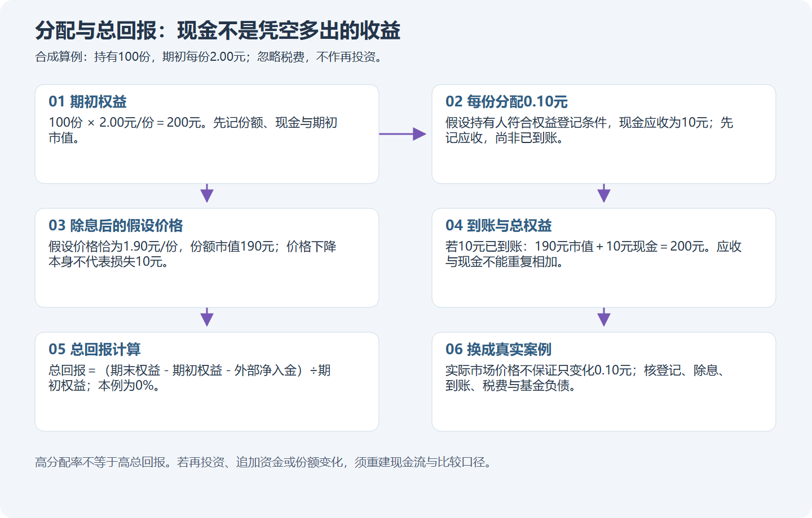

# 模块十九：上市基金的开关、现金管理与不动产生命周期

基金在交易所能买卖，只说明存在一种交易渠道。它是否接受申购赎回、投资什么、何时分配、有没有有限存续期，仍要逐项读合同。本模块用小林的同一本账户比较封闭期基金、货币基金与公募REITs。真实公告用于核身份和事件，合成数字用于练计算；不把产品名称直接当操作规则。

Tutor: Give the lesson for one part with its location identifier for each tutor message. Give its one last question. Before correction, keep the raw response.

This is guided instruction. Full examples of product changes show outcomes. In [practice](../product-practice.md), [atlas](../product-atlas.md), and [worked sheets](../product-worked-sheets.md), use only the packet for this step. For a previous cutoff, do not open subsequent reports or teacher suffixes.

[Primary sources](../product-sources-cb-other.md) record dates, the applicable scope, and unknown fields. From these solutions, you cannot be sure of paper-trading acceptance or proficiency without aid.

## 第一单元：封闭的是申赎，不一定是交易

### 第一讲：同样在交易所挂牌，份额进出的门可以不同

先把两个动作分开。交易是投资者之间按市场价格转让既有份额，买方的钱交给卖方；申购赎回是投资者按产品规则与基金办理份额增加或退出，涉及净值、确认、资金支付和可能的暂停。前者能做，不证明后者随时能做。若封闭期内有人想退出，可能只能找二级市场买方，而买方未必愿意按净值接手。

严格意义的封闭式基金，在合同规定的封闭安排下不办理日常赎回，份额与存续安排按合同执行；定期开放基金则把封闭期和开放期交替安排；还有先封闭若干年、期满转为上市开放式基金LOF的产品。LOF是一种上市开放式基金形式，不表示此刻所有渠道都无条件开放。名称中的“持有一年”还可能约束单笔份额持有期限，与整个基金统一封闭不是一回事。

小林查到真实例子506006：它叫汇添富科创板2年定期开放混合型证券投资基金。管理人2026年8月20日公告第三次开放期为8月24日至9月4日，并明确9月5日起进入下一封闭期，不接受申购赎回。因此到本课核验日10月20日，依据这份公告安排可以识别其处于新封闭期；不能因为2020年成立至今已超过两年，就断言永久开放。它是定期开放基金，不应改称份额永久固定的传统封闭式基金。[当前封闭期来源](../product-sources-cb-other.md#closed-current)保留了公告原文与日期。

读此类产品要问四件事：当前代码对应哪个合同版本；这一天处在哪个阶段；哪一渠道接受什么操作；份额何时可用。若在场外登记，想在交易所卖出，还可能需要跨系统转托管，提交和完成不是同一时间；闭市、停牌或确认延迟也会阻断计划。

普通基金竞价买入通常按100份或其整数倍申报，基金价格刻度为0.001元；这些数量规则与申购起点是两回事。按2026年7月6日实施的沪深交易规则，普通封闭期基金没有因为上市而取得当日回转例外，通常次交易日才可卖出；个别品种仍须另核。特殊基金也可能有不同涨跌幅安排。不要把一般默认10%直接填成506006的限制；本课没有认证它的特殊限制和全部实时申报条件。缺关键条件，先保留观察与算术练习，停止模拟该笔现实订单。[现行规则及适用例外](../product-sources-cb-other.md#fund-trading)说明了这个边界。

自然检查：506006在2026年8月能赎回，为什么不能由此推断10月20日也能赎回？

### 第二讲：旧名字与折价都不能替代合同

真实反例是501080。中金基金2022年7月8日发布的产品资料明确：原“中金科创主题3年封闭运作灵活配置混合型证券投资基金”于2022年7月11日期满转型，名称改为“中金科创主题灵活配置混合型证券投资基金（LOF）”，接受按新规定办理的场内外申购赎回。2026年的交易所身份页和披露仍把它列作LOF。若搜索结果继续显示旧的“三年封闭”名称，只能说明历史名称留存，不能证明它2026年仍处在当年的封闭期。见[转型公告及当前交叉核对](../product-sources-cb-other.md#closed-counterexample)。

再看为什么封闭安排常与“折价”一起讨论。净值可以理解为每份基金按规定计算的净资产价值；市场价是买卖双方愿意成交的价格。合成例子：已知且当时可用的净值1.00元，市场价0.80元，折价率＝1−0.80÷1.00＝20%。若净值不变、最后确实能按1.00元退出，从0.80涨到1.00的收益率则是25%，因为这次分母换成买入成本0.80元。20%折价不等于保证赚20%。

还剩多久封闭会影响等待成本。相同折价，剩半年和剩五年不是相同机会；期间投资组合会变、净值会跌、管理费会持续从基金资产扣除，市场折价也可能扩大。若最终可实现价值跌到0.70元，0.80元买入仍亏12.5%，即使原来的20%折价看起来很大。

更不能拿今天成交价除以很久以前净值，称作可兑现的实时折价。资料必须写净值所对应日期、什么时候公布、市场报价时间与币种。到期转型也不是按旧净值给每人发现金；可能只是换了运作安排和申赎通道，还要看暂停、确认和转托管。终止合同则进入清算，债务、费用与资产变现结果都会影响剩余分配。

小林在[CLOSED工作表](../product-worked-sheets.md)把“名称核验—阶段—折价分母—剩余期限—退出通道”接起来。没有合格的真实封闭基金行情包，可以做这个明确标注的合成练习，不能拿已转LOF的501080日线冒充封闭基金日线。

自然检查：看到501080旧资料里有“三年封闭”，小林还需要哪一项带生效日期的资料，才能判定2026年的运作方式？

## 第二单元：货币基金的收益与渠道要一起看

### 第一讲：场内货币基金不是一种统一的买卖按钮

货币市场基金主要投资现金管理所需的短期货币市场工具。它仍是基金：持有人取得基金份额，承担资产和流动性风险；不是把钱存进银行后取得一项相同性质的存款债权。“低风险”“用于闲置资金”都不等于保本、固定利息、随时无限额取现。收益会随市场利率、费用与资产情况变化。

场内只是渠道描述。交易所资料把实时申赎货币基金与交易型货币基金分列：前一类可能通过场内系统申购赎回，却不在二级市场挂牌买卖；后一类存在买价卖价，可通过市场交易。市面还常说“申赎型、交易型、交易兼申赎型”，这些简称便于描述，不能代替某只产品各渠道的实际权限。应分别问：能否二级市场买卖，能否按该渠道申赎，申赎何时确认，现金何时可用。见[交易所类别来源与限制](../product-sources-cb-other.md#money-types)。

真实例子511880，在银华基金2026年4月30日送出的资料中，场内简称是“银华日利”，扩位简称“银华日利ETF”，属于银华交易型货币市场基金的上市A类份额。B类003816、C类015557不是同一交易代码。基金名称带ETF与它属于货币基金可以同时成立：ETF描述交易及份额机制，货币描述资产与用途，不必在二者中选一个当作唯一分类。

最容易混的是价格显示。511880的A类采用收益不结转份额的全价计价，收益通常体现在净值内，再按本产品合同分配；不能套用“所有货币基金净值固定1元、每天自动增加份额”的说法。其C类每日分配再投资的机制，也不能移到A类上。净值保留几位小数，是估值显示精度；交易报价每次最小能变多少，是交易所刻度，二者不同。[当前产品资料与招募说明书](../product-sources-cb-other.md#money-identity)记载了这种区别。

按沪深现行规则，上市交易货币基金有当日回转例外，买入当天可以再卖出；511880的场内交易也应结合基金交易的100份买入单位和0.001元价格刻度理解。它不代表每次申购、赎回、卖出、现金提取都即时完成。若节前限购或暂停申购，可能改变套利与现金安排；二级市场交易是否继续须单独查，不能见到“暂停申购”就擅自写“停牌”。

自然检查：511880能在市场买卖，为什么仍不能把其C类每天增加份额的规则直接用到511880的上市A类？

### 第二讲：七日年化是观察指标，账户收益要另算

“年化”是把一段时间的收益按约定方法换算成年尺度，便于比较。七日年化基于最近七天的收益表现，不是管理人承诺未来一年按这个数付息。万份收益则表示规定数量份额在某一天对应的已实现收益，既不是每个人都能收到同样金额，也不是所有份额类别都采用相同的显示方式。

先做完全合成的估算：假设10,000元、未来七天恰好维持简单年化1.8%、按365天近似，则10,000×1.8%×7÷365≈3.45元。它只是说明量级；真实七日年化可能采用复利口径，未来每日收益会变，持有份额的收益权起止也有合同规定。不能把屏幕上的1.8直接乘本金，也不能把这3.45元写成已到账现金。

二级市场买卖还带来价差。另一个独立合成例子：100份货币基金以100.10元/份买入、100.12元/份卖出，价差毛收入为2元；假设外部往返费用共3元，交易净差额为−1元。若产品收益已经包含在全价变动中，就不能又把同一期间的估算收益加一次。若另有真实现金分红，按是否取得权益及实际到账单另列。基金净值已计提的管理托管等费用，也不能在个人账户再扣一次。

511880的2026招募说明书说明A/B类年度现金分配的合同安排，但本课没有取得其2026年实际分配公告，不能预写某天必到账多少。合同中的基准日与具体分配实施公告、实际账户收款不是一个证据层级。假设遇到分红，原始价格或净值可能下降，要连同现金看总回报，不能见到价格下跳就把全部变化解释成市场损失。

小林在[MONEY工作表](../product-worked-sheets.md)先写钱何时要用，再查买卖价差、最小数量、交易费用、限额、暂停、交收与银行卡可取时间。若明早必须提款，而现金何时可取尚未知，这就是不能据以执行本次现金管理计划的具体理由；收益率看起来更高也不能补上时间缺口。该练习只用现金，不开展杠杆、回购或衍生品操作。

自然检查：七日年化显示1.8%时，小林为什么还不能把未来七天3.45元当作肯定收到的存款利息？

## 第三单元：公募REITs从募资走到项目现金流

### 第一讲：基础设施与商业不动产是2026年要分别识别的类别

公募REITs可以先理解成把不动产项目权益放进基金及相关载体，由专业机构运营，再按规则分配现金的上市产品。投资者买到基金份额，并非直接拿到一间可以自己入住、出租或抵押的房产。资产支持证券、项目公司等中间载体连接基金与底层资产，基金托管、项目运营与资产权利也不是同一职责。

以508000为例，2026年的当前名称是“华安张江产业园封闭式基础设施证券投资基金”，扩位简称“华安张江产业园REIT”；“华安张江光大园”是2023年更名前的名称。按代码核对历史连续性时，要保留这段更名，不能把数据源的旧名当成另一只新产品。[身份及招募说明书](../product-sources-cb-other.md#reit-508000)说明其基础设施类别和具体项目权益。

截至2026年，不能再把所有公募REITs都写成基础设施基金。上交所2026年6月18日报道首批商业不动产REITs实际上市，涵盖商业零售、商业办公楼等业态。汇添富上海地产商业REIT（508600）的上市公告在6月11日公布，确定6月18日上市；6月19日送出的资料又确认了其封闭式商业不动产基金身份。后一个文件可作后来核对，不能充当前一周已可获得的资料。[官方报道与产品公告](../product-sources-cb-other.md#reit-commercial)保留了时间关系。

类别要依据监管框架和合同，不是看见购物中心就一律归“新商业试点”：消费基础设施此前也已进入基础设施REITs范围。同样，项目是收费公路、产业园还是商业楼，只告诉我们现金流来源的一部分；要继续核查权属、剩余使用年限、租约或收费机制、负债和维护安排。经营权有限的项目可能随着经营期消耗价值，不能假定永续拥有。

沪深现行REIT规则对普通交易设上市首日30%、之后10%的涨跌幅限制；价格刻度0.001元。普通竞价买入的100份单位与询价、大宗等方式的数量规定须分开。REIT没有货币基金的当日回转例外，买入后通常下一交易日才可卖，不等于届时一定有买家。规则见[2025年末更新的REIT办法](../product-sources-cb-other.md#reit-rules)。

新基金初次发售是“认购”，不是二级市场买入。参与还要核价格、资格、战略或公众份额、配售比例、缴款、未获配退款与可上市份额。若申请100份、合成配售只得40份，就只记40份，退款尚未到账的60份对应资金仍单列，不能记成100份已买入。真实战略份额还可能限售，本课不据上市首日推定所有份额都可自由出售。

自然检查：2026年看见一只REIT持有购物中心，小林为什么仍应读其监管类别和合同，而不能单凭底层外观判断属于哪种REIT？

### 第二讲：项目收入、负债、净值与可分配现金是四件事

租金或收费进入项目，并不全部落到基金持有人手中。项目要支付运营、维护、税费和融资成本，还可能偿还债务、保留必要资本开支。净利润按照会计规则计算，可供分配金额则在相应基础上调整折旧摊销、公允价值变动及其他项目；因此账面利润与当期能分出的现金可能不同。

合成项目一年收租100万元，运营等现金支出30万元，利息10万元，需偿债本金20万元，预留维修10万元，简化剩余现金为30万元。若另有折旧15万元，它会影响会计利润，却不是今年又付出去一次现金。这个算例故意简化，不能当正式REIT可供分配金额公式；正式口径需逐项对照基金报告和适用指引。借更多钱可以短期增添现金，也会增加利息、再融资和还款压力，不等于租客经营变好了。

公募REITs按规定将不低于合并后年度可供分配金额的90%分配，是对特定分母的要求。若合成年度可供分配金额只有30万元，90%对应27万元，而不是给每个投资者的本金赚90%。现金分配高也可能包含资产经济价值随年限消耗而返还的部分，不能把全部现金都当永续新增利润。

净值是另一把尺。508000的2026招募说明书明确：可供分配金额预测和不动产评估结果不代表实际现金分配或资产实际可交易价格。资产估值有模型与假设，账面折旧、资产负债及估值时点也会影响数值。市场价低于某个公布净值，不能证明随时能按净值赎回，因为该产品采取封闭运作，没有日常赎回这扇门。

其合同存续期为自首次基金合同生效之日起35年。这个基金期限、土地使用权剩余期限、每个项目经营权到期、某笔贷款到期仍须分别核查，不能用一个35年覆盖全部现金风险。假设项目负债临近到期而出租率走低，即使分红历史稳定，也要重新检查现金能否覆盖还款。

在[REIT债务与现金工作表](../product-worked-sheets.md)中，把收入、必要支出、债务本金利息、预留、净利润调整和最终分配分别写一行。这样才看得出“多分了现金”来自运营改善、减少预留，还是其他一次性安排。

自然检查：合成年度可供分配金额30万元，要求分配至少90%，为什么不能理解为投资者本金获得90%收益？

## 第四单元：把分配、扩募和清算接回总回报

### 第一讲：2026分红案例要分开基准、登记、除息与收款

收益分配基准日用于计算这次可分配金额；权益登记日确定哪些份额享有分配；除息日调整交易参考；现金发放日是付款安排。四个日期作用不同。知道某份报告截至12月31日，不代表12月31日就已知道后来公告的分配金额。

真实508000公告于2026年4月14日送出，分配基准日为2025年12月31日，本次每10份派0.5486元，称为2025年度第二次分配。它是2026年公布并实施的事件，不能改写成“2026年经营赚到的全部收益”。场内权益登记4月16日、除息4月17日、现金发放4月22日；场外除息与收款日期另有安排。公告还明确登记日场内买入享有、卖出不享有，并暂停4月14日至16日跨系统转托管。[原始分配公告](../product-sources-cb-other.md#reit-distribution)逐项支持这些日期。

假设小林确有1,000份符合本次权益，按公告比例只计算应得毛现金：1,000÷10×0.5486＝54.86元。这没有证明他真实持有或券商已支付；4月17日账上可以先记分配应收，实际收到再移到现金。若提前卖出失去权益，不能仍计54.86元。未核到原始盘中发布时间，本案例也不证明4月14日开盘前已能看到公告。

看下图时，比较分配前后“份额市值＋现金”的合计，而不是只看现金流入那根箭头。

另做完全合成的价格算例：持1,000份，买价2.80元，后来每份现金分配0.05元、期末价格2.75元，无其他费用，合计价值2,750＋50＝2,800元，收益为0。若买卖外部费用共4元，就亏4元。分配本身把一部分资产变成现金，不会凭空增加财富。实际市场除息后价格还会受交易影响，不能保证恰好只下降分配额。

原始价格图可能显示除息下跳；复权图可能已处理分配影响。计算总回报要说明使用哪一种，不能在已含分配的收益序列上再加现金一次。真实508000行情与事件是否完整匹配，应在[图谱](../product-atlas.md)的当前包核验，不能用上述合成2.80元价补齐真实历史。

自然检查：合成例中收到50元现金、份额市值同时减少50元，为什么不能只拿50元除以买入成本作为整个持有期收益？

### 第二讲：扩募、终止和不交易，也要走完整四步

REIT扩募是按规定增加基金份额并购入项目等资产的安排，不是把原有投资者的持仓免费放大。新项目估值、买入价格、融资方式、关联交易、发行份额与费用，都会影响原持有人每份权益。合成例子：原资产100万元、100万份，每份1元；按1元增发20万份得20万元，同时买入值20万元项目，忽略费用后仍约每份1元，而不是每份涨20%。若买贵或项目现金流低于预期，还可能损害原持有人利益。

是否享有优先配售、是否参与、缴款日期、未配退款与新增份额限售，要逐项读扩募公告。扩募不是开放每天赎回，也不等于历史高分配将延续。遇到停牌、暂停或转托管延迟，记录“申请待确认”“资金冻结”“份额不可卖”，不可用预计数量先卖出。新项目尚未交割，也不能提前算作既有租金收入。

基金到期或其他终止条件触发后，可能进入资产处置与清算。卖出项目、回收应收款、支付负债和清算费用、再分剩余财产，需要时间且价格未知。合成清算：资产变现90万元，偿债25万元、费用5万元，剩余60万元；若共100万份，每份可分0.60元。不能把原估值1元当作保底清算价。终止上市也不等于现金同日全部到账，有限经营权到期还可能有合同规定的移交安排。

现在按[产品模拟流程](../product-practice.md)做四步：第一步核身份、类别、日期和操作；第二步写计划或具体不交易理由；第三步记录订单、配售、分配、暂停及截止；第四步核对份额和现金、费用与总回报，并与同期限恰当基准比较。CLOSED侧重阶段与退出通道，MONEY侧重净收益和现金何时可取，REIT侧重项目现金、债务和权益事件；共同框架不能抹去三条轨道的差异。

小林若已有产业园股票、相关行业基金，又买产业园REIT，仍可能集中暴露于相近经济风险；增加包装数量不证明分散。FOF表示主要投资其他基金的方式，QDII表示相关境外投资资格与敞口安排，不能凭这两个词决定T+规则。基金内含期货等工具时，仍要理解相应风险；本课不进行衍生品、融资融券实际操作。

缺历史净值可用时间，就不声称真实折价；缺现金可取日，就不执行依赖次晨提款的计划；缺扩募公告，就不假定参与后能立即卖出。完整写明缺口与下一项核验，才是有依据的不交易。学习是否进步看解释、记录和纠错，不能由分红多、一次盈利或答题数量代替。

自然检查：合成扩募后资产和份额同增20%，为什么不能直接认定原持有人每份财富也增加20%？
