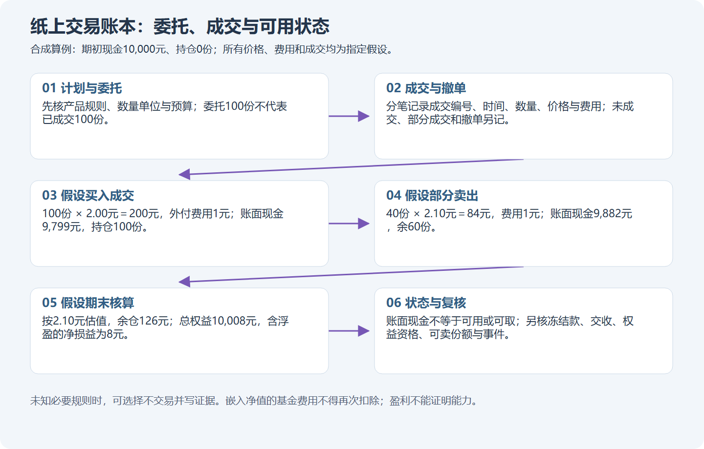

# M20 多品种完整交易训练：让计划、事件与账目对得上

本章将所选产品专章接到M03、M04、M10、M13—M14的交易过程。先完成M15与所选品种基础；不要求先掌握缠论。课内“完整”指把一笔纸面交易的关键状态走通，不代表建立了可获利策略或具备实盘资格。

## U01 从观察名单到可执行计划

### P01 先筛选能理解的产品

先看产品而不是追涨幅榜。写下代码、完整名称、市场、份额类别、管理目标、投资范围、基准、规模与流动性资料所属日期，再检查暂停、终止、赎回或转股等公告。基金规模大，不保证你希望成交的价位有足够买卖盘；历史成交额大，也不保证未来没有价差或冲击。

ETF还要识别行业集中和同类持仓；LOF要分清场内买卖与申赎通道；可转债要核对发行人信用、正股与条款；REIT要看项目、杠杆、分配和剩余期限；货币基金要看收益方式与可用时间；封闭运作基金要看剩余封闭期和届满安排。候选池是“值得继续研究”的清单，不是购买清单。资料不足的产品可放入待核查区。

**随口确认：**两只名称相近的科技基金，为什么还要比较持仓、指数或管理目标和份额类别？

### P02 把图形观察写成事前条件

从[真实产品图谱](../product-atlas.md)选一张当前观察图，只写可见事实：截止日、未复权口径、当前收盘与前收关系、此前20根均量与当日量的比较、用哪些日期和价格画出的支撑压力。先固定锚点再观察后续，不能移动压力线让历史交易看起来总是正确。不要把除息缺口当成纯技术破位，不从放量推断已经知道谁在“出货”。

计划至少包含：入场条件、失效条件、最大可投入现金、计划风险、数量与单位、订单方式、事件日检查、退出条件，以及等待或放弃的条件。**明确的教学规则示例：**资料齐全且无未解决事件，收盘越过此前10根最高价才形成下一交易日观察候选；若次日开盘已超出事前最高接受价，就放弃。止损价不是交易所自动保证成交的价格。这条规则用于训练一致性，优势尚未验证。

**随口确认：**如果次日开盘跳过计划价格，为什么不能仍按昨天收盘价给模拟交易记成交？

## U02 风险、数量与多条分支

### P01 用现金和计划风险双重限制数量

在简化现金买入例中，数量同时受现金与计划风险约束。假设入价1元、停止参考价0.90元、风险预算50元、买卖各2元固定费用，每份计划损失0.10元。先为两笔费用留4元，余46元除以0.10得460份；再按假设100份增量向下取整为400份。现金还必须足够覆盖400元买入金额与2元买入费用。这些是假设参数；真实增量和费率必须查规则卡。

如果价格直接跌到0.80元才成交，损失会超过原计划；停止价只能参与计划，不构成损失保证。更稳妥的核查是加入跳空、价差、流动性不足和暂停情景，观察额外损失。对可转债，先确定报价分母与张数：每张面额100元、报价每100元面额120元，10张金额为1200元，再加费用；不能把“10张”当10元或把一手与一张混用。

**随口确认：**如果现金约束只允许300份，而风险约束允许400份，计划数量应是多少？为什么不能取平均？

### P02 放弃、等待和条件成交都是合法分支

建立三条事前分支：条件满足且操作资格齐全时如何行动；价格或资料不满足时如何等待；事件变化时如何退出或重新核查。**不交易**要说明具体缺什么、会改变什么判断、何时再查，不能只写“风险大”就视为完成分析。也不能因为后来上涨就把当时谨慎的决定改判错误。

本课六条[训练线](../product-practice.md)都允许保留自己的不交易决定。教师在后续给出的假设成交只是一条独立核算支线，不会把你改写成已经买入。已看过案例或答案的训练记录为辅助练习；即使换个题号也不会自动获得“独立未知行情”标签。

**随口确认：**你因净值时间不明而等待，老师随后提供一组假设买卖价格进行算账。这是不是证明你当时买入了？两份记录应如何区分？

## U03 委托、持仓与事件管理

### P01 未成交的部分不能记入持仓

假设准备买1000份，订单先成交600份，再成交200份，余200份撤单。成交持仓是800份，不是计划的1000份。订单需要记录委托编号、申报时间、价格数量、各笔成交编号和实际费用；已报、部分成交、撤单申请与撤单确认各有状态。若某段规则下买入份额当日不可卖，持仓800份也可能当日可卖0份。资金可用、冻结、可取仍要分别记录。

日线最低价达到你的限价，不足以证明轮到了你的订单；每日开高低收也不能判断盘中先止盈还是先止损。真实图只练观察，完整成交练习使用显式的模拟撮合报告。价差、滑点和手续费各记一处，不把“成本”重复扣除。

**随口确认：**订单显示“部分成交600份，撤单中”，此时剩余400份已经确定撤掉了吗？你应记录什么不确定状态？

### P02 事件会改变可选择的操作

事件管理从“什么时候公布、什么时候生效、最后什么时候能做什么”开始。可转债停止交易日、最后转股日、赎回登记与付款日不同；选择转股还涉及股票数量取整、残余金额和股票可卖时点。LOF暂停申购，可能只堵住申购路径，不能自动推断二级市场同时停止交易；转托管申请已提交，也不代表份额已经可卖。分红则要分清权益登记、除息和现金到账。

每次事件后更新状态表：现金可用/冻结/可取，证券持有/可卖/冻结，待确认份额，待到账现金，转换后股票与残余款，以及来源和确认时间。[产品工作表](../product-worked-sheets.md)提供具体支线。计算器只算提供的现金流，不会替你确认历史资格、分红权益或交收完成。

**随口确认：**一只转债已经停止交易，但尚处于公告列明的转股期，是否能把“不能卖债”直接写成“任何操作都不能做”？还要查什么？

## U04 对账、比较与复盘

### P01 分红和价格变化合起来算

**教学假设：**1000份REIT在3元买入，买入费2元；满足假设权益条件后收到每份0.10元现金；随后以2.90元卖出，卖出费2元。买入支出3002元，分配到账100元，卖出净收2898元，最终净结果为−4元。分配100元不等于净赚100元，价格亏100元也不等于经济结果必然亏100元。真实收益还要检查剩余持仓、税费与现金时点。

若只卖出600份，剩余400份应按声明的估值时点列示，不能把全部价格变化都当已经实现，也不能将未卖部分当现金。对账要求：期初现金＋各笔现金流＝期末现金；期初数量＋买入−卖出＋转换等变化＝期末数量。开放持仓缺估值时，完整总收益应记未知。使用净值收益时还要避免重复扣基金内含费用。

**随口确认：**收到100元分配但市值少100元，就能说“分红收益100元”作为整笔交易的净利润吗？

### P02 评估过程，也评估结果的证据强度

复盘分开两张表。过程表记录当时知道什么、是否按规则、为何等待、哪里发生执行偏差；结果表记录净损益、最大回撤、持有时间、成本、相同口径基准，以及缺失的行情或账目。**回撤**是资产从此前高点向下的幅度；例如账户从1万元升到1.1万元再降到9900元，相对高点回撤10%，不是相对最初资金只亏1%就算回撤1%。完整区间内这类跌幅的最大值称最大回撤；有入金或出金还需调整比较口径。拿价格涨幅与含分配的总收益比较，会得出错误结论。小样本高胜率不能证明优势；一次亏损也不能独自否定一套尚未充分验证的规则。

组合还要穿透：一只科技股、一只重仓同类公司的ETF、一只该公司可转债，可能重复暴露于同一风险。用共同市场下跌、利率上升、汇率变化和流动性收缩做压力情景，分别看价格影响、可执行性和现金需要。不要给所有品种强行套同一止损比例。再从复盘中挑一个最需要补讲的机制，而不是不断加指标直到历史图看起来完美。

完成所选训练后，保留原始回答、支持程度、规则卡、分支、订单及现金账，再进行阶段反馈。正式入口见[多品种阶段练习](../exercises/product-stage.md)。课程不要求投入真实资金，也不会从一组模拟收益推断你已经会稳定盈利。

**随口确认：**两笔交易都赚钱，其中一笔违反事前规则，另一笔按规则执行。复盘为什么要给它们不同的过程记录？
