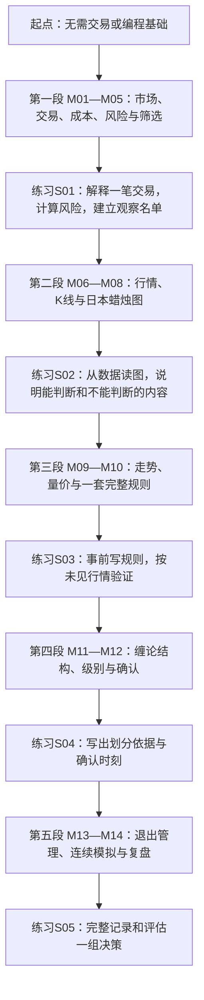
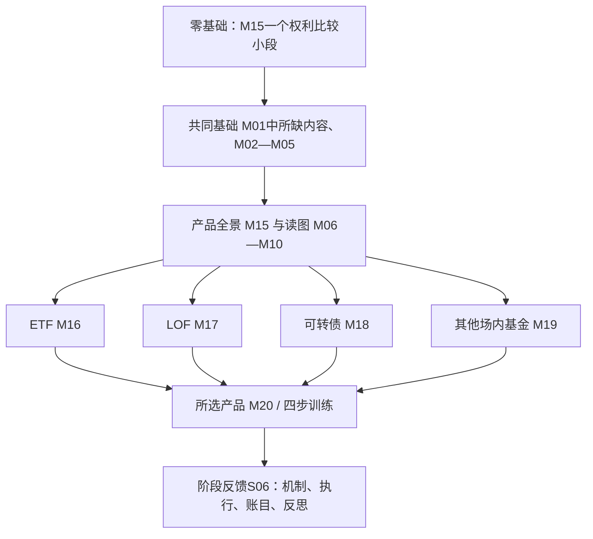

# 学习路线

## 默认：从零系统学习

第一段的风险核算、筛选和订单练习会延续到后续课程。练习结果用于决定补讲什么；不会用“看完一章”替代理解证据，也不要求先通过一份繁重考试才能继续。

## 为什么按这个顺序学

提问前，要先讲过题目所需的概念、符号、计算和判断方法，并用例子示范。课件里出现过一个词，不等于已经向你讲清楚。你若没学过，或暂时想不起来，先补讲，再练习；不会把课后才介绍的方法算作你漏答。

换数据、换图练习，可以检查能否运用已学方法。老师先用另一组数据示范，不会为了补课提前展示待测图的后续走势或答案。讲过、跟着会做、独立会做，分别记录。

| 从哪里来 | 接下来解决什么问题 | 为什么接得上 |
| --- | --- | --- |
| M01 股东身份与回报 | M02 账户、场所与业务 | 知道买到什么，再了解通过什么账户和市场持有它 |
| M02 账户与市场 | M03 委托与成交 | 能进入市场后，还要分清报单、排队与实际成交 |
| M03 成交与交易限制 | M04 交收、费用和风险 | 成交价格之外，还要算何时能用钱、成本及可能损失 |
| M04 成本与风险 | M05 公司信息与筛选 | 算得出损失后，再判断哪些标的及事件需要排除或核查 |
| M05 信息时点与观察名单 | M06 行情字段 | 有了候选，学习怎样读当时可见的报价与成交记录 |
| M06 价格、成交量与单位 | M07 K线 | 把一段时间的成交价格压缩成图，先读懂四价与时间范围 |
| M07 K线的几何与比较基准 | M08 蜡烛形态 | 先会读单根，再比较相邻几根；形状本身不保证走势 |
| M08 形态与背景 | M09 趋势、支撑与压力 | 把局部形态放回连续高低点，找到事前可说明的区域 |
| M09 结构与失效边界 | M10 量价、指标与完整规则 | 加入成交活跃程度，再把观察连接到仓位、退出和验证 |
| M07、M09、M10 的读图与规则基础 | M11 包含、分型、笔与线段 | 换用明确的结构划分方法，逐层检查构造和确认时点 |
| M11 基本构件 | M12 中枢、级别、背驰与买卖点 | 有了构件，再讨论它们的关系；不先背买卖点名称 |
| M04 风险与 M10 完整规则 | M13 持仓和退出管理 | 计划写好后，练条件变化时怎样行动；可先不学缠论 |
| M13 管理与记录 | M14 连续模拟与复盘 | 把单次决策连接起来，再区分执行质量和盈亏结果 |
| 已学的持有权利、交易和风险 | M15 多品种全景 | 比较不同产品买到的权利；产品优先者可先学其中一个权利比较 |
| M15 权利与交易、申赎的区别 | 所选 M16 ETF／M17 LOF／M18 可转债／M19 其他场内基金 | 先选一类，再学它的净值、债权或事件机制；各产品课不互为必修前课 |
| 所选产品机制、共同交易基础与 M10 规则 | M20 完整产品训练 | 将识别、计划、执行和核算连成一条过程；缺哪项先补哪项 |

每个小段也按同样的关系衔接：回到你刚会做的事，提出下一步的问题，解释新概念，示范后再问。若你只想查一个概念或读完整讲义，可以直接讲解，不强制先答题。

## 产品优先路线：可以先学基金或可转债

如果你明确想先学ETF等产品，第一小段从[M15的持有权利](modules/module-15.md#u01-p01)开始。先讲你实际持有什么，再补M01中缺少的权利与收益基础、M02账户与业务、M03委托、M04费用和风险。进入M06—M10前，还要补M05的信息时点、权益事件和筛选基础；这些内容决定怎样理解报价变化、公告和观察名单。不要求先完成缠论。

每条训练都经过“识别并核规则→制定计划或放弃→委托与事件管理→核算复盘”。ETF和货币基金等训练类别存在重叠，不能当成互斥产品分类。选择M19后可分别走封闭基金、货币基金和REIT三条训练线。

系统路线在原M01—M14之后加入M15—M20，共20模块、80单元、160起始小段。已有学习者按实际证据补缺，旧课程游标和回答保留。当前产品练习均为辅助训练，后续可另安排未知案例验证；不能把同一图换个名字当成未见行情。

机制算例见[工作表](product-worked-sheets.md)，原图见[多品种2026图谱](product-atlas.md)，完整训练见[产品练习](product-practice.md)。详细是逐步讲透，不代表一次塞入全部课纲。

## 先走通交易过程

需要先理解完整交易过程时，可走M01—M10，再学M13—M14，之后回到M11—M12深化缠论。每一部分仍需其基础知识。M10的简单规则用于训练“条件—行动—记录—验证”，收益优势尚未建立。

## 缠论深化

要系统学完附件，请在 M11—M12 之后走[全书路线](chan-book/index.md)。从[逐节课程](chan-book/full-course.md)按前置关系学习。每节先看讲解和图，再做题；交答后核答案。现有 M01—M20 的学习进度不必重来。

M10 可配合[量价实训](volume-price.md)，依次练同图双窗口、走势对照、条件验证和截点迁移。已经走到场内产品课的学员，可加做五种产品的量价证据题。

先检查M07的K线、M09的结构、M10的比较与验证基础，再进入M11—M12。不能将“看过一段缠论讲解”记作已理解级别或中枢。不同划分方法采用何种定义，要在同一案例中明确。

## 每次如何学

通常一轮用15—30分钟，可只学一个小段，也可讨论多个往返。时长只是安排示例，不是固定要求。先由老师解释和画图，你用自己的话回答一个小问题；若有困难，换一个更小的例子。阶段末再做一份正式练习。

你可随时说“讲慢一点”“展开完整讲义”“先解释这个词”“暂停并保存进度”。概念查询后保留原来的学习位置。

## 如何判断进步

| 层次 | 可观察的表现 |
| --- | --- |
| 理解 | 用自己的话解释概念，能区分相邻概念 |
| 应用 | 对一份新数据完成计算、画图或规则判断 |
| 执行 | 在信息受限的回放中按事前计划行动或放弃 |
| 记录 | 分清观察、计划、委托、成交和结果 |
| 评估 | 指出证据、偏差、不确定性及下一步验证范围 |

模拟获利不直接证明实盘能力。课程完成也不要求投入真实资金。学习证据与策略盈利证据分别记录。

## 图形实践线

M06读成交量单位与比较基准，M07回到真实OHLC与影线，M08核对形态及反例，M09画支撑压力并观察突破/破位，M10将量价判断接到风险计划，M11—M12再逐层画缠论。见[32专题真实图谱](chart-atlas.md)、[看盘手册](chart-reading.md)与[缠论实图](chan-real-charts.md)。每次先保留当前观察，再看后续；已看过答案的图不算未见测试。

## 2026主案例入口

真实图形实践优先用[2026科技股与高波动图谱](tech-2026-atlas.md)和[2026缠论图谱](chan-2026-atlas.md)；原茅台、平安等2024例为补充。按原图—原答—标注—验证推进。做[量价实训](volume-price.md)时，只用该题的题面、规则和截点图表。全部股票题原答保存后，再读含事后披露的[数据与权益事件说明](data-2026.md)。[看盘手册](chart-reading.md)可查读图方法。
