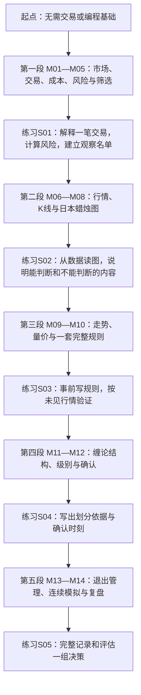
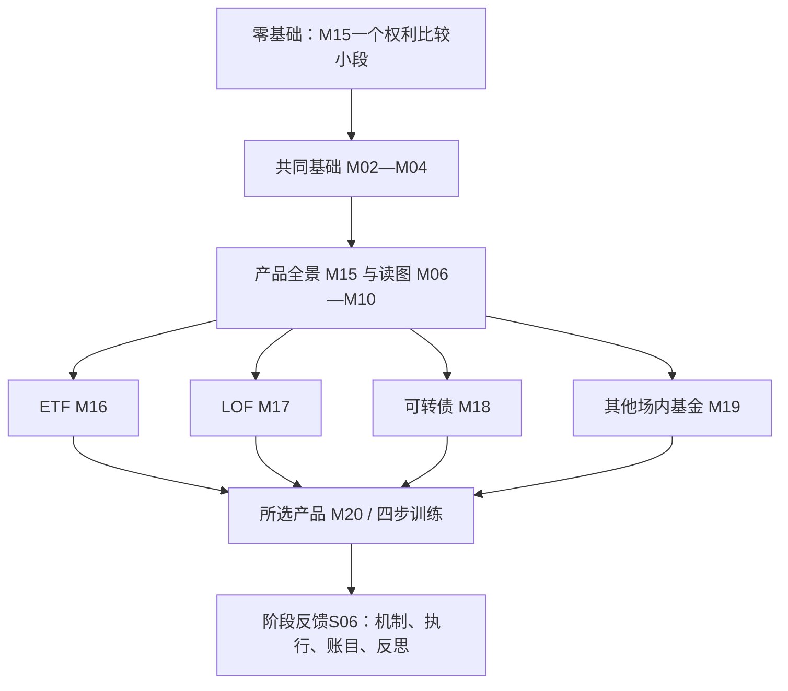

# 学习路线

## 默认：从零系统学习

第一段的风险核算、筛选和订单练习会延续到后续课程。练习结果用于决定补讲什么；不会用“看完一章”替代理解证据，也不要求先通过一份繁重考试才能继续。

## 产品优先路线：可以先学基金或可转债

如果你明确想先学ETF等产品，第一小段从[M15的持有权利](modules/module-15.md#u01-p01)开始。先讲你实际持有什么，再补M02账户与业务、M03委托、M04费用和风险。之后用M06—M10学习必要的行情、K线、量价与事前规则；不要求先完成缠论。

每条训练都经过“识别并核规则→制定计划或放弃→委托与事件管理→核算复盘”。ETF和货币基金等训练类别存在重叠，不能当成互斥产品分类。选择M19后可分别走封闭基金、货币基金和REIT三条训练线。

系统路线在原M01—M14之后加入M15—M20，共20模块、80单元、160起始小段。已有学习者按实际证据补缺，旧课程游标和回答保留。当前产品练习均为辅助训练，后续可另安排未知案例验证；不能把同一图换个名字当成未见行情。

机制算例见[工作表](product-worked-sheets.md)，原图见[多品种2026图谱](product-atlas.md)，完整训练见[产品练习](product-practice.md)。详细是逐步讲透，不代表一次塞入全部课纲。

## 先走通交易过程

需要先理解完整交易过程时，可走M01—M10，再学M13—M14，之后回到M11—M12深化缠论。每一部分仍需其基础知识。M10的简单规则用于训练“条件—行动—记录—验证”，收益优势尚未建立。

## 缠论深化

先检查M07的K线、M09的结构、M10的比较与验证基础，再进入M11—M12。不能将“看过一段缠论讲解”记作已理解级别或中枢。不同划分方法采用何种定义，要在同一案例中明确。

## 每次如何学

通常一轮用15—30分钟，可只学一个小段，也可讨论多个往返。时长只是安排示例，不是固定要求。先由老师解释和画图，你用自己的话回答一个小问题；若有困难，换一个更小的例子。阶段末再做一份正式练习。

你可随时说“讲慢一点”“展开完整讲义”“先解释这个词”“暂停并保存进度”。概念查询后保留原来的学习位置。

## 如何判断进步

| 层次 | 可观察的表现 |
| --- | --- |
| 理解 | 用自己的话解释概念，能区分相邻概念 |
| 应用 | 对一份新数据完成计算、画图或规则判断 |
| 执行 | 在信息受限的回放中按事前计划行动或放弃 |
| 记录 | 分清观察、计划、委托、成交和结果 |
| 评估 | 指出证据、偏差、不确定性及下一步验证范围 |

模拟获利不直接证明实盘能力。课程完成也不要求投入真实资金。学习证据与策略盈利证据分别记录。

## 图形实践线

M06读成交量单位与比较基准，M07回到真实OHLC与影线，M08核对形态及反例，M09画支撑压力并观察突破/破位，M10将量价判断接到风险计划，M11—M12再逐层画缠论。见[32专题真实图谱](chart-atlas.md)、[看盘手册](chart-reading.md)与[缠论实图](chan-real-charts.md)。每次先保留当前观察，再看后续；已看过答案的图不算未见测试。

## 2026主案例入口

真实图形实践优先用[2026科技股与高波动图谱](tech-2026-atlas.md)和[2026缠论图谱](chan-2026-atlas.md)；原茅台、平安等2024例为补充。先核[数据、权益事件及可知时间](data-2026.md)，再配合[看盘手册](chart-reading.md)按原图—原答—标注—验证推进。
