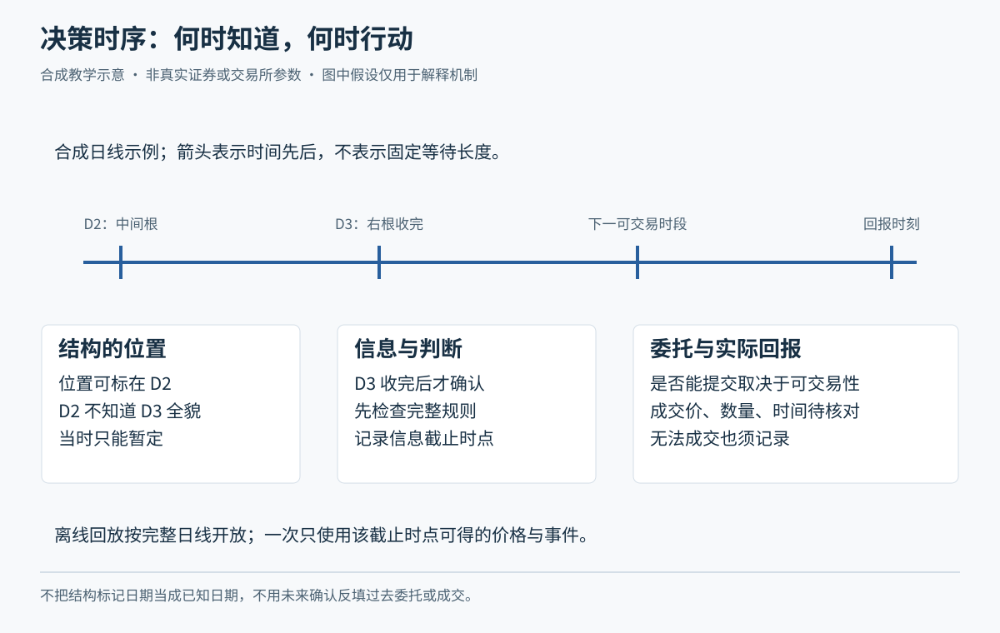
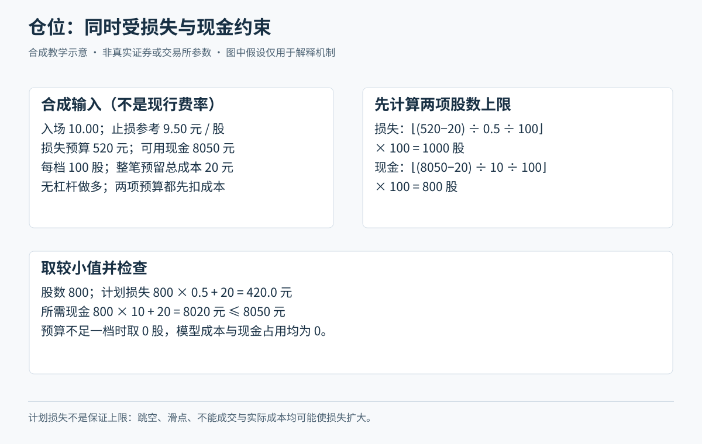

# 完整交易过程与练习

核心问题是：在当时可得的信息和适用规则下，是否有一项有依据、可执行、风险可承担的行动？分析完成也可以选择继续观察或放弃。所有练习先使用虚构案例，不需要真实账户或资金。

## 先建立练习条件

先用虚构人物比较不同资金期限、看盘条件和风险承担能力，再逐步形成自己的学习目标。风险意愿是愿意承受多少波动；损失承受能力取决于资金用途、负债和生活安排。无需先披露具体家庭资产才开始上课。账户权限和产品适当性另按当前规则核验。

初期使用普通股票现金买入的教学情景，分别学习股票、ETF、可转债等品种的规则。日线可作为第一组练习的主图，分钟图用于解释观察过程。正式风格选择还需比较持有期限、可观察时间和实际风险。

产品优先学习者可从[M15](modules/module-15.md)进入共同基础，再选择M16 ETF、M17 LOF、M18可转债或M19其他场内基金，接[M20完整训练](modules/module-20.md)。[六条产品训练](product-practice.md)使用明确的纸面成交和事件假设；[真实2026产品日线](product-atlas.md)供读图，不证明实际下单、申赎或套利已经可执行。操作规则和状态核对见[工作表](product-worked-sheets.md)。不要将股票的数量、费用、可卖安排直接外推。

## 一轮练习如何完成

1. **圈定范围。** 写明股票池、数据日期、流动性和公告检查范围。记录候选和排除理由。避免看完涨幅榜才回头选择“原本应该买”的股票。
2. **解释背景。** 分别记录市场、行业、公司信息和价格事实。区分公开信息、个人推断和待验证的资金意图。
3. **等待条件。** 把机会背景与触发行动分开。例如处于上升结构只是背景，某个已确认价格条件才是规则触发。指标名称本身不是完整规则。
4. **事前写计划。** 指定入场、退出、数量、费用假设、可执行时间、无交易条件、风险限制和规则版本。
5. **核算风险。** 以计划入场和计划退出的价差估计损失，加入明确成本预留，再同时检查现金和股份申报单位。组合中相似持仓需要一起考虑。
6. **记录委托与成交。** 已报不等于成交。保留提交、撤单、部分成交、剩余数量、成交价格、费用及资金股份变化。
7. **管理与退出。** 根据事前的亏损、盈利、时间或逻辑失效条件管理。加减仓属于新决策，重新核算组合风险。跳空、停牌或流动性不足须记录实际限制。
8. **复盘并验证。** 分开记录遵守计划的程度、分析假设、净收益、回撤和执行偏差。汇总多个案例之后再讨论方法是否值得继续。

## 计划风险的计算示例

以下全部为合成教学假设：计划10元买入，9.5元退出，计划损失预算520元，可用现金8050元，练习数量按100股一组，预留总费用20元。

每股计划价差为0.5元。先扣预留费用，损失预算允许1000股；现金允许800股，因此选择800股。计划现金占用8020元，按计划价差退出时的估计损失420元。这里的100股是本题假设，不能替代某只证券的申报规则。

若真实退出价为9元，价差损失已变为800元，还需计算实际费用。因此“计划损失420元”不是损失上限保证。也不能只把止损价写进表格，就当作已有可成交订单。

## 回放与信息时点

从[第零帧](../assets/replay/frame-00.html)开始。每帧只含当时可见的数据，点击下一帧才揭示新观察。先保存判断及理由，再向前推进。老师在你回答前只读取这一帧；完整合成数据和教师材料留到反馈或资料维护时再读。

这组短回放训练观察和信息时点，不承担M10完整规则的回测。要实际走通该规则的准备期、盘口、部分成交、撤单和退出，可用[21日准备期的六段交易案例](strategy-case.md)。每个包只在到达相应阶段后读取。

一根OHLC线只说明开、高、低、收，不说明高低先后。如果某根K线同时覆盖计划止损和止盈，且没有更细数据，就不能凭想象确定谁先触发。触及价格仍不等于实际成交。

收盘后才能确认的信号，执行时间须放在确认之后。公司公告也使用其实际公开和可用时间，不能把后来公布的消息放回先前决策。

## 方法验证与行为训练

先固定一版规则和解释，再选取未见行情验证。记录尝试过的修改，保留失败与放弃案例。比较费用后的结果、风险、持仓暴露和适当基准。只挑获利样本、忽略退市股票、反复调参或使用未来复权信息，都会改变结论的可信度。

练习中的好结果可能来自偶然；坏结果可能发生在遵守规则时。评价执行需要看当时的信息及计划，评价方法则要看整体证据。模拟成交也不能验证真实排队、冲击成本或情绪反应。

行为训练使用具体情景：错过机会后是否追价；亏损后是否任意加量；是否为避免认亏而扩大退出距离；是否因一笔盈利改变规则。把这些行为写成可检查的暂停和复核条件，而非泛泛要求“保持心态”。

## 练习模板

- [目标与条件](../assets/templates/profile.md)：比较交易风格和资金条件。
- [观察名单](../assets/templates/watchlist.md)：记录筛选、排除与信息来源。
- [交易规则卡](../assets/templates/strategy-card.md)：固定完整规则和版本。
- [风险核算](../assets/templates/risk-worksheet.md)：数量、费用、组合与执行假设。
- [决策日志](../assets/templates/journal.md)：记录交易和未交易选择。
- [方法评估](../assets/templates/evaluation.md)：分开检查过程、结果和证据范围。

这些表格在学习者自己的记录目录填写；安装的skill保持教材原样。真实交易不作为结业要求，是否尝试由学习者另行决定。

## 2026主案例入口

真实图形实践优先用[2026科技股与高波动图谱](tech-2026-atlas.md)和[2026缠论图谱](chan-2026-atlas.md)；原茅台、平安等2024例为补充。先核[数据、权益事件及可知时间](data-2026.md)，再配合[看盘手册](chart-reading.md)按原图—原答—标注—验证推进。
